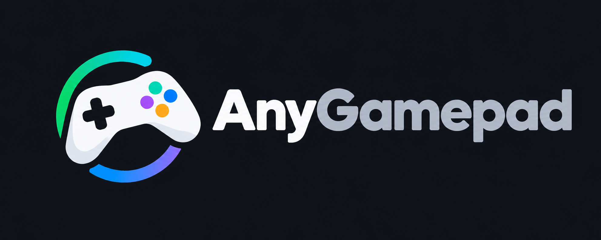

# anygamepad



Gamepad input normalization: one canonical gamepad model for every controller,
mode, transport and operating system.

- Web app: <https://anygamepad.github.io> (not live yet)
- Plan: [ROADMAP/2026-10-31/](ROADMAP/2026-10-31/README.md)
- Privacy: <https://anygamepad.github.io/privacy/> (maintainer side:
  [docs/privacy/](docs/privacy/README.md))
- Contributor and agent rules: [AGENTS.md](AGENTS.md)

## Layout

| Path | Content |
|------|---------|
| `crates/anygamepad` | Public facade crate used by games |
| `crates/anygamepad-model` | Canonical gamepad model types |
| `crates/anygamepad-db` | Device profile format and embedded database |
| `crates/anygamepad-report` | Device report schema shared by apps and server |
| `crates/anygamepad-virtual` | Virtual controller outputs (desktop app only) |
| `crates/anygamepad-wasm` | `wasm-bindgen` bindings used by the web app |
| `apps/` | Web app, desktop app and ingestion server |
| `data/profiles/` | Curated device profiles |
| `data/controllers/` | Controller catalog: models, modes and how to connect them |
| `data/lab/` | Lab inventory format (units and machines of the test lab) |
| `data/reports/` | Device report format, schema and example |
| `data/test-reports/` | Test report format, schema and example; the test reports the lab keeps |
| `docs/adr/` | Architecture decision records |
| `docs/privacy/` | Consent texts, retention and the handling of shared reports |

## Development

```sh
cargo fmt --all
cargo clippy --workspace --all-targets -- -D warnings
cargo test --workspace

# WebAssembly: build, then run the browser tests in headless Chrome.
cargo build --workspace --exclude anygamepad-virtual --target wasm32-unknown-unknown
cargo install wasm-bindgen-cli --version <wasm-bindgen version in Cargo.lock>
cargo test -p anygamepad-wasm --target wasm32-unknown-unknown
```

The browser tests need `chromedriver` (or `geckodriver` for Firefox) in `PATH`,
or its path in the `CHROMEDRIVER` (`GECKODRIVER`) environment variable.

The web app (`apps/web`, Node 22.12+ and wasm-pack 0.15) has its own
commands; see [apps/web/README.md](apps/web/README.md).

## CI and releases

- [`build.yml`](.github/workflows/build.yml) runs on every push and pull
  request: formatting, clippy and tests on Linux, Windows and macOS, browser
  tests in Chrome and Firefox, the MSRV check, and the web app build (size
  budget, smoke test). Each run keeps the built web app and WebAssembly
  bindings as artifacts; pushes to `main` deploy the web app to GitHub Pages.
- [`release.yml`](.github/workflows/release.yml) cuts a release: Actions,
  Release, Run workflow on `main`, then pick `patch`, `minor` or `major`. It
  runs `build.yml` with the new version; once that passes it commits
  `Release vX.Y.Z`, tags `vX.Y.Z` and publishes a GitHub release with
  `anygamepad-web-vX.Y.Z.zip`, `anygamepad-wasm-vX.Y.Z.zip` and
  `SHA256SUMS`. A failed release pushes nothing.

The version lives in `Cargo.toml`, `Cargo.lock` and `apps/web/package*.json`;
`node scripts/version.mjs` reads, checks and sets it in all of them.

## License

Licensed under either of [Apache License, Version 2.0](LICENSE-APACHE) or
[MIT license](LICENSE-MIT) at your option.

Unless you explicitly state otherwise, any contribution intentionally submitted
for inclusion in this work, as defined in the Apache-2.0 license, shall be
dual licensed as above, without any additional terms or conditions.

Device reports (the ones people share, the dataset made of them and the
reports in `data/reports/`) are dedicated to the public domain under
[CC0 1.0](data/reports/LICENSE-CC0); see
[data/reports/](data/reports/README.md#license).
