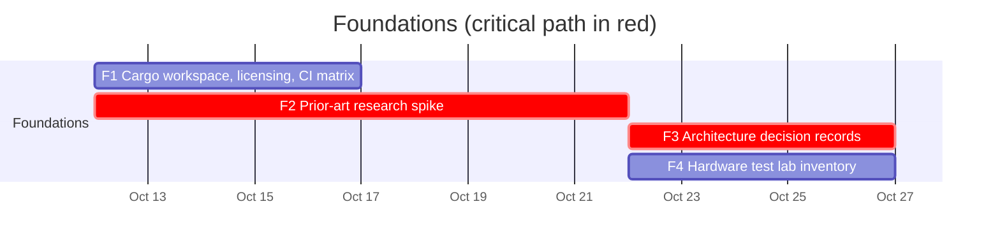

# 00 — Foundations

Groundwork that unblocks every other workstream. See the
[master schedule](README.md#master-schedule) for the global view.

## Schedule



## Tasks

| ID | Task | Days | Blocked by | Blocks | Start | End | Slack |
|----|------|-----:|------------|--------|-------|-----|------:|
| F1 | Cargo workspace, licensing, CI matrix | 5 | - | C1, W1 | 2026-10-12 | 2026-10-17 | 10 |
| F2 | **Prior-art research spike** | 10 | - | F3, F4 | 2026-10-12 | 2026-10-22 | 0 |
| F3 | **Architecture decision records** | 5 | F2 | C1, C2, A1 | 2026-10-22 | 2026-10-27 | 0 |
| F4 | Hardware test lab inventory | 5 | F2 | D3 | 2026-10-22 | 2026-10-27 | 35 |

### F1 — Cargo workspace, licensing, CI matrix

- Create the Cargo workspace with the proposed layout (final layout confirmed by
  F3):

  ```text
  crates/
    rustpad/          # public facade crate used by games
    rustpad-model/    # canonical gamepad model types
    rustpad-db/       # device profile format and embedded database
    rustpad-report/   # device report schema shared by apps and server
    rustpad-virtual/  # virtual controller outputs (desktop app only)
  apps/
    desktop/
    web/
    server/
  data/
    profiles/         # curated device profiles
  docs/adr/           # architecture decision records
  ```

- Choose and add the license (proposal: `MIT OR Apache-2.0`, the Rust
  ecosystem default; compatible with importing the zlib-licensed SDL
  GameControllerDB).
- CI on Linux, Windows and macOS: `cargo fmt --check`, `cargo clippy
  -- -D warnings`, `cargo test`, plus a `wasm32-unknown-unknown` build check.
- Check crate name availability on crates.io.

**Done when:** an empty workspace builds and passes CI on the three OSes.

### F2 — Prior-art research spike

Study and summarize (in `docs/research/`):

- SDL3 gamepad subsystem: positional button naming (`SOUTH/EAST/WEST/NORTH`),
  GUID format, HIDAPI drivers for PlayStation/Nintendo/Xbox controllers.
- SDL GameControllerDB (community mapping database).
- Rust crates: `gilrs`, `hidapi`, `evdev`, `windows`, `objc2`/IOKit bindings,
  `sdl3` bindings.
- DS4Windows, ViGEmBus, HidHide, Steam Input, JoyShockLibrary.
- Linux kernel drivers `xpad`, `hid-playstation`, `hid-nintendo`,
  `hid-microsoft`, and how they rename/remap axes.
- Browser Gamepad API differences (Chromium, Firefox, Safari): `id` string
  format, `"standard"` mapping availability, WebHID support.

Output: a build-vs-reuse recommendation (wrap SDL3/gilrs vs own backends).

### F3 — Architecture decision records

Write ADRs in `docs/adr/NNNN-title.md` for:

1. Canonical model naming (positional vs label-based buttons).
2. Input backend strategy per OS (own vs wrapped library).
3. Device profile file format (TOML vs JSON) and schema tooling.
4. Desktop UI toolkit (Tauri vs egui vs Slint; Tauri would let the desktop app
   reuse web tester UI components).
5. Web stack and server stack (proposal: TypeScript frontend + core compiled to
   WASM; Rust `axum` + `sqlx` + PostgreSQL server).

**Done when:** ADRs are merged with status `accepted`.

### F4 — Hardware test lab inventory

List the controllers physically available, their supported modes and
transports, and which OS machines are available to test them. This feeds the
initial curated profiles (D3) and the testing matrix.
