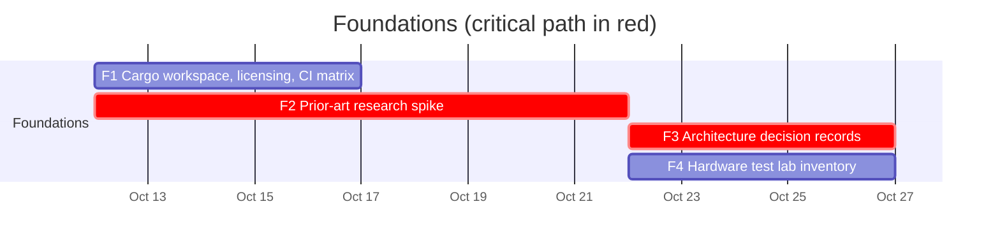

# 00 — Foundations

Groundwork that unblocks every other workstream. See the
[master schedule](README.md#master-schedule) for the global view.

## Schedule



## Tasks

| ID | Task | Days | Blocked by | Blocks | Start | End | Slack |
|----|------|-----:|------------|--------|-------|-----|------:|
| F1 | Cargo workspace, licensing, CI matrix | 5 | - | C1, W1 | 2026-10-12 | 2026-10-17 | 10 |
| F2 | **Prior-art research spike** | 10 | - | F3, F4 | 2026-10-12 | 2026-10-22 | 0 |
| F3 | **Architecture decision records** | 5 | F2 | C1, C2, W1, A1 | 2026-10-22 | 2026-10-27 | 0 |
| F4 | Hardware test lab inventory | 5 | F2 | D3 | 2026-10-22 | 2026-10-27 | 90 |

### F1 — Cargo workspace, licensing, CI matrix

- Create the Cargo workspace with the proposed layout (final layout confirmed by
  F3):

  ```text
  crates/
    anygamepad/          # public facade crate used by games
    anygamepad-model/    # canonical gamepad model types
    anygamepad-db/       # device profile format and embedded database
    anygamepad-report/   # device report schema shared by apps and server
    anygamepad-virtual/  # virtual controller outputs (desktop app only)
    anygamepad-wasm/     # wasm-bindgen JS/TS bindings used by the web app
  apps/
    desktop/
    web/
    server/
  data/
    profiles/            # curated device profiles
  docs/adr/              # architecture decision records
  ```

  Crates use the `anygamepad` name and prefix (`rustpad` is taken on crates.io;
  the repository and project keep the name rustpad).

- Choose and add the license (proposal: `MIT OR Apache-2.0`, the Rust
  ecosystem default; compatible with importing the zlib-licensed SDL
  GameControllerDB).
- CI on Linux, Windows and macOS: `cargo fmt --check`, `cargo clippy
  -- -D warnings`, `cargo test`, plus a `wasm32-unknown-unknown` build and
  `wasm-bindgen-test` tests in a headless browser.
- Reserve the names early with placeholder releases: `anygamepad` on crates.io
  and on npm (for the WASM package).

**Done when:** an empty workspace builds and passes CI on the three OSes.

### F2 — Prior-art research spike

Study and summarize (in `docs/research/`):

- SDL3 gamepad subsystem: positional button naming (`SOUTH/EAST/WEST/NORTH`),
  GUID format, HIDAPI drivers for PlayStation/Nintendo/Xbox controllers.
- SDL GameControllerDB (community mapping database).
- Rust crates: `gilrs`, `hidapi`, `evdev`, `windows`, `objc2`/IOKit bindings,
  `sdl3` bindings.
- DS4Windows, ViGEmBus, HidHide, Steam Input, JoyShockLibrary.
- Linux kernel drivers `xpad`, `hid-playstation`, `hid-nintendo`,
  `hid-microsoft`, and how they rename/remap axes.
- Browser Gamepad API differences (Chromium, Firefox, Safari): `id` string
  format, `"standard"` mapping availability, WebHID support.
- Rust to WebAssembly tooling: `wasm-bindgen`, `web-sys` Gamepad and WebHID
  bindings, `wasm-pack`/Trunk, TypeScript type generation.

Output: how to combine the providers (native, SDL3, gilrs, web): which devices
each handles best, how to avoid two providers opening the same device, SDL
hints needed to coexist with native drivers.

### F3 — Architecture decision records

Write ADRs in `docs/adr/NNNN-title.md` for:

1. Canonical model naming (positional vs label-based buttons).
2. Input provider strategy. Direction agreed: aggregate native, web, SDL3 and
   gilrs providers with per-device arbitration (see the
   [overview](README.md#input-provider-strategy)); the ADR fixes priorities
   and Cargo features.
3. Device profile file format (TOML vs JSON) and schema tooling.
4. Desktop UI toolkit. Requirements: **performance first** (low input-to-pixel
   latency, low idle CPU and memory) and an **always-on-top widget** (A11).
   Recommendation: **egui** (`eframe` with the `wgpu` renderer): pure Rust in
   the same process as the library (no IPC, no webview), immediate mode suited
   to live input at high refresh rates, multiple native windows (viewports),
   and per-window always-on-top, transparency, no decorations and mouse
   pass-through through winit. Alternatives: iced (similar, less mature
   multi-window), Slint (good performance, but its licensing options need
   review), Tauri (rejected: webview memory/CPU cost, and transparent overlay
   windows are fragile on Linux). Validate with a small prototype measuring
   idle CPU, memory and latency on the three OSes before accepting the ADR.
5. Web stack and server stack. Already decided: the web app uses the anygamepad
   library compiled to WebAssembly. To decide: frontend framework and bundler
   (an egui gamepad visualization could also be embedded in the page as a WASM
   canvas to share it with the desktop app); server proposal is Rust
   `axum` + `sqlx` + PostgreSQL.

**Done when:** ADRs are merged with status `accepted`.

### F4 — Hardware test lab inventory

List the controllers physically available, their supported modes and
transports, and which OS machines are available to test them. This feeds the
initial curated profiles (D3) and the testing matrix.
