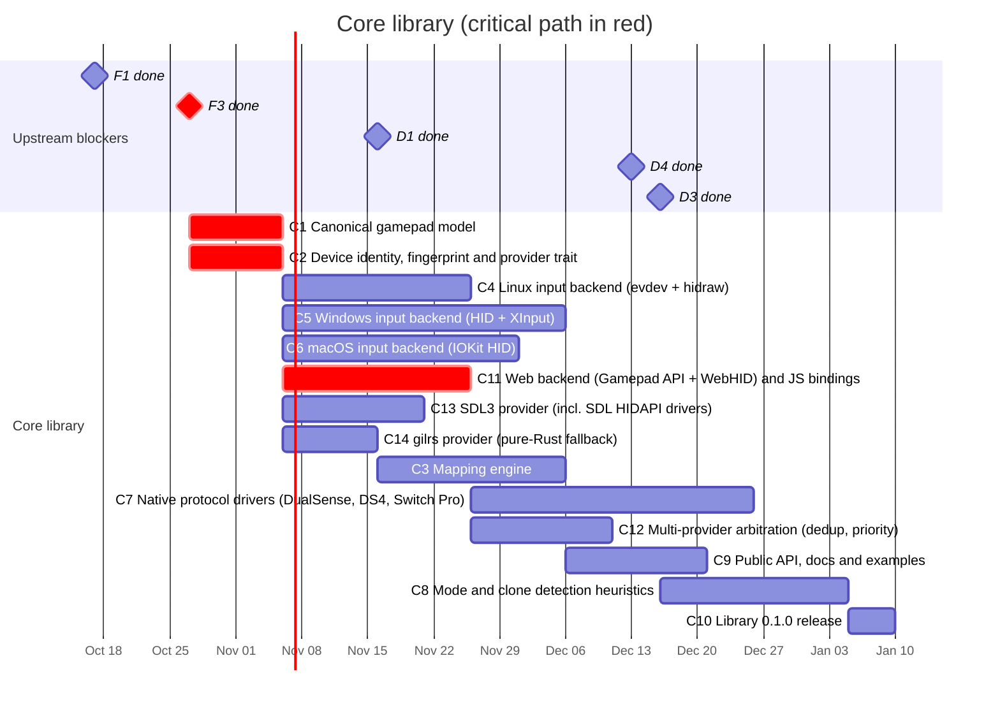

# 01 — Core library

The `omnipad` crate: what Rust games import. It hides devices, modes, transports and OS differences behind one
canonical gamepad model.

Input comes from several **providers** (native, web, SDL3, gilrs) arbitrated
per device; see the [provider strategy](README.md#input-provider-strategy).

## Schedule

Upstream blockers from other files are shown as milestones on the date they are
expected to be done.

## Tasks

| ID | Task | Days | Blocked by | Blocks | Start | End | Slack |
|----|------|-----:|------------|--------|-------|-----|------:|
| C1 | **Canonical gamepad model** | 10 | F1, F3 | C3, C4, C5, C6, C11, C13, C14, A4 | 2026-10-27 | 2026-11-06 | 0 |
| C2 | **Device identity, fingerprint and provider trait** | 10 | F3 | C4, C5, C6, C11, C13, C14, D1, P1 | 2026-10-27 | 2026-11-06 | 0 |
| C3 | Mapping engine | 20 | C1, D1 | C8, C9, D4, W5, M1 | 2026-11-16 | 2026-12-06 | 13 |
| C4 | Linux input backend (evdev + hidraw) | 20 | C1, C2 | C7, C8, C12, D3, A2, A5 | 2026-11-06 | 2026-11-26 | 55 |
| C5 | Windows input backend (HID + XInput) | 30 | C1, C2 | C10, A6, A7 | 2026-11-06 | 2026-12-06 | 65 |
| C6 | macOS input backend (IOKit HID) | 25 | C1, C2 | C10, A6, A8 | 2026-11-06 | 2026-12-01 | 60 |
| C7 | Native protocol drivers (DualSense, DS4, Switch Pro) | 30 | C4 | C10 | 2026-11-26 | 2026-12-26 | 70 |
| C8 | Mode and clone detection heuristics | 20 | C3, C4, D3 | C10 | 2026-12-16 | 2027-01-05 | 60 |
| C9 | Public API, docs and examples | 15 | C3 | C10 | 2026-12-06 | 2026-12-21 | 75 |
| C10 | Library 0.1.0 release | 5 | C5, C6, C7, C8, C9, C11, C12, C14, D4 | A10, M3 | 2027-01-05 | 2027-01-10 | 60 |
| C11 | **Web backend (Gamepad API + WebHID) and JS bindings** | 20 | C1, C2 | C10, W2, M1 | 2026-11-06 | 2026-11-26 | 0 |
| C12 | Multi-provider arbitration (dedup, priority) | 15 | C4, C13 | C10 | 2026-11-26 | 2026-12-11 | 85 |
| C13 | SDL3 provider (incl. SDL HIDAPI drivers) | 15 | C1, C2 | C12 | 2026-11-06 | 2026-11-21 | 90 |
| C14 | gilrs provider (pure-Rust fallback) | 10 | C1, C2 | C10 | 2026-11-06 | 2026-11-16 | 110 |

### C1 — Canonical gamepad model

- **Positional** face buttons (`South`, `East`, `West`, `North`) so game logic
  does not depend on the label printed on the button; plus a **label/glyph**
  layer (`A/B/X/Y`, `Cross/Circle/Square/Triangle`, Nintendo `B/A/Y/X`) for UI
  prompts.
- D-pad, shoulders, triggers (analog + digital), sticks and stick clicks,
  `Start/Select/Home/Share/Capture`, back paddles, touchpad (points + click),
  motion sensors (gyro/accelerometer in SI units), battery, connection type.
- Output capabilities: rumble (including dual-motor and HD rumble as optional
  capabilities), lightbar/player LEDs, adaptive triggers (optional).
- Every feature is described by a capability set, so games can query what a
  device supports.

### C2 — Device identity, fingerprint and provider trait

Identity is more than VID/PID: bus type (USB, Bluetooth, BLE), version, product
string, HID report descriptor hash, OS, OS driver that owns the device
(`xpad`, `hid-playstation`, XUSB, HID, ...), browser and its Gamepad API
`id`/`mapping` when running on the web backend (C11), and detected mode.
Shared with the device database (D1) and the report schema (P1).

Also defines the `Provider` trait every input source implements (enumerate,
hotplug, open, read raw state, output) and how a provider describes the
identity of what it sees.

### C3 — Mapping engine

Applies a device profile to raw elements: button remap, axis
inversion/range/center calibration, combined axes (e.g. Xbox triggers on a
single HID axis in DirectInput mode), hat-to-dpad, dead zones. Pure and
deterministic so it can be unit-tested and runs unchanged in WebAssembly (C11).

### C4 — Linux native provider

`evdev` for devices bound to kernel drivers and `hidraw` for devices we drive
ourselves; hotplug via udev. Document required permissions (udev rules).

### C5 — Windows native provider

Raw Input / HID for generic devices, XInput for XUSB devices (note: XInput does
not expose VID/PID, correlate with the HID/PnP device tree). Evaluate
GameInput as a future replacement.

### C6 — macOS native provider

IOKit `IOHIDManager` for HID devices; evaluate the GameController framework
for devices Apple claims exclusively.

### C7 — Native protocol drivers

Talk directly to devices over HID to unlock features hidden by generic
drivers. Drivers are **transport-agnostic** (sans-IO: they consume and produce
reports, the backend moves the bytes) so the same code runs over hidraw,
Windows HID, IOKit and WebHID:

- DualSense / DualShock 4: full Bluetooth reports (these pads start with a
  reduced report until a calibration feature report is read), IMU calibration,
  lightbar, rumble.
- Switch Pro Controller: handshake and subcommands to enable full report mode
  and IMU, player LEDs, rumble.

### C8 — Mode and clone detection heuristics

Decide which profile applies when VID/PID is ambiguous: report descriptor
fingerprints, feature-report probing, product strings, per-OS quirks. Built on
the initial curated profiles (D3).

### C9 — Public API, docs and examples

Polling and event APIs, hotplug events, capability queries, examples (minimal
game loop, Bevy integration example).

### C11 — Web backend and JS bindings

The library runs in the browser as WebAssembly; the web app (04) is built on
it.

- Web input backend for `wasm32-unknown-unknown` using `web-sys`: Gamepad API
  (polled from `requestAnimationFrame`, connect/disconnect events) and WebHID
  (Chromium, opt-in, user gesture required).
- `omnipad-wasm` crate: `wasm-bindgen` API and generated TypeScript types for
  the web frontend (device list, raw and canonical state, wizard, reports).
- Rust games compiled to WASM get the same backend for free.

### C12 — Multi-provider arbitration

- Correlate devices seen by several providers into one physical device
  (VID/PID, bus, OS device path/instance ID).
- Pick the owning provider per device from profile hints and a default
  priority (native protocol driver > SDL3 HIDAPI driver > native generic >
  gilrs); the others ignore that device.
- Configure SDL hints so SDL does not grab devices a native driver owns.
- Collection mode can open every provider in observe-only mode to record how
  each one sees the device.

### C13 — SDL3 provider

Optional `sdl3` Cargo feature using SDL3 (zlib license) through Rust bindings:
gamepad and joystick APIs, SDL HIDAPI drivers, GameControllerDB mappings,
sensors, rumble, LEDs. Decide static vs dynamic linking and document the build
requirements.

### C14 — gilrs provider

Optional `gilrs` Cargo feature: pure-Rust fallback for games that cannot link
C libraries.

### C10 — Library 0.1.0 release

Publish to crates.io; semver policy; changelog.

**Done when:** a sample game reads the same canonical input from at least one
Xbox, one PlayStation and one Switch-style controller on Linux, Windows,
macOS and in the browser (Chromium and Firefox) through WebAssembly.
