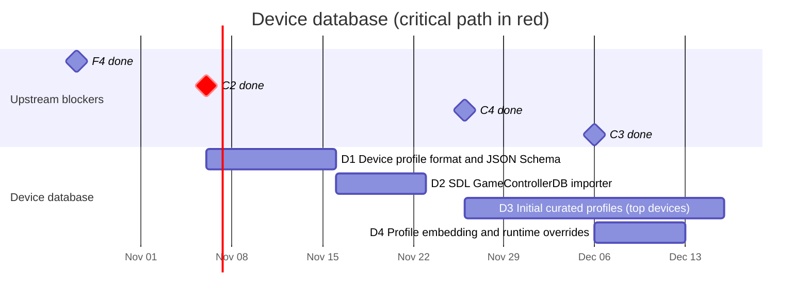

# 02 — Device database

Curated, versioned device profiles that tell the mapping engine how to turn a
specific device (in a specific mode, on a specific OS and transport) into the
canonical model.

## Schedule

## Tasks

| ID | Task | Days | Blocked by | Blocks | Start | End | Slack |
|----|------|-----:|------------|--------|-------|-----|------:|
| D1 | Device profile format and JSON Schema | 10 | C2 | C3, D2, D3, D4, P1, P4 | 2026-11-06 | 2026-11-16 | 13 |
| D2 | SDL GameControllerDB importer | 7 | D1 | W5 | 2026-11-16 | 2026-11-23 | 33 |
| D3 | Initial curated profiles (top devices) | 20 | D1, C4, F4 | C8 | 2026-11-26 | 2026-12-16 | 60 |
| D4 | Profile embedding and runtime overrides | 7 | D1, C3 | C10, W5, M1 | 2026-12-06 | 2026-12-13 | 13 |

### D1 — Device profile format and JSON Schema

- One file per device family in `data/profiles/`, human-reviewable in PRs.
- A profile has **match rules** (identity fields from C2, optionally OS,
  transport and descriptor fingerprint) and **mappings** (raw element ->
  canonical element plus calibration).
- Per-OS/per-transport/per-browser overrides inside the same profile, because
  the same pad differs between Windows, Linux and macOS, and browsers apply
  their own Gamepad API remapping.
- Schema version field; JSON Schema published for tooling and the web app.

### D2 — SDL GameControllerDB importer

Bootstrap coverage by converting SDL GameControllerDB entries into anygamepad
profiles (marked `source = "sdl-gamecontrollerdb"`, `verified = false`).
Keep attribution and license notice.

### D3 — Initial curated profiles

Hand-verified profiles for the devices in the hardware lab (F4), at least:
Xbox 360, Xbox One/Series, DualShock 4, DualSense, Switch Pro Controller, and
multi-mode third-party pads (8BitDo, GuliKit) in each of their modes. Verified
first on Linux (the first backend available), then on Windows and macOS as C5
and C6 land.

### D4 — Profile embedding and runtime overrides

Profiles are embedded at compile time (no network access needed by games) and
can be overridden by a user/game-provided file at runtime. The same embedded
database ships inside the web app's `.wasm` bundle, so a compact encoding may
be needed to keep the bundle small.
