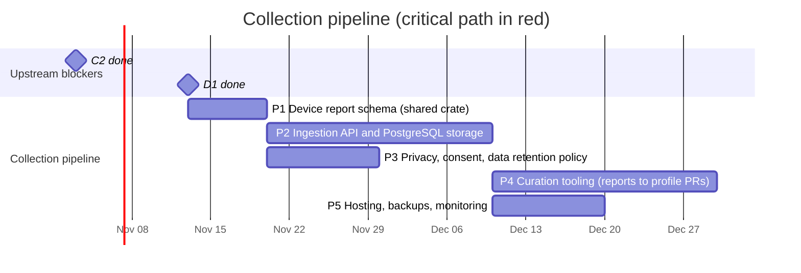

# 03 — Collection pipeline

Backend that receives device reports from the web app and the desktop app,
stores them, and turns them into curated profile updates.

## Schedule

## Tasks

| ID | Task | Days | Blocked by | Blocks | Start | End | Slack |
|----|------|-----:|------------|--------|-------|-----|------:|
| P1 | Device report schema (shared crate) | 7 | C2, D1 | P2, P3 | 2026-11-13 | 2026-11-20 | 6 |
| P2 | Ingestion API and PostgreSQL storage | 20 | P1 | P4, P5, W5, A3 | 2026-11-20 | 2026-12-10 | 6 |
| P3 | Privacy, consent, data retention policy | 10 | P1 | W5, A3 | 2026-11-20 | 2026-11-30 | 16 |
| P4 | Curation tooling (reports to profile PRs) | 20 | P2, D1 | - | 2026-12-10 | 2026-12-30 | 21 |
| P5 | Hosting, backups, monitoring | 10 | P2 | W6 | 2026-12-10 | 2026-12-20 | 26 |

### P1 — Device report schema

Shared crate `rustpad-report` (plus generated JSON Schema / TypeScript types)
describing a report:

- Source (web or desktop), app/browser version, OS and version.
- Identity fields (C2): VID/PID, version, bus, names as reported by each API
  (e.g. the browser Gamepad `id` string, which differs between browsers).
- Raw data when available: HID report descriptor, sample input reports,
  button/axis counts, browser `mapping` value.
- User-confirmed mapping from the guided wizard (W3) and the mode the user says
  the controller is in.
- **Never** serial numbers, Bluetooth MAC addresses or any personal data:
  stripped on the client and validated again on the server.

### P2 — Ingestion API and PostgreSQL storage

Rust `axum` service (shares types with the library), PostgreSQL storage,
schema validation, deduplication by fingerprint, rate limiting, and an
anonymous submission token.

### P3 — Privacy, consent, data retention

Privacy policy, explicit consent screen text, retention periods, GDPR data
handling (no IP addresses stored beyond rate limiting), public data license for
the aggregated dataset.

### P4 — Curation tooling

Aggregate reports per fingerprint, show disagreements between reports, and
generate profile PRs for `data/profiles/` that a maintainer reviews.

### P5 — Hosting, backups, monitoring

Deployment target, automated backups, uptime and error monitoring.
