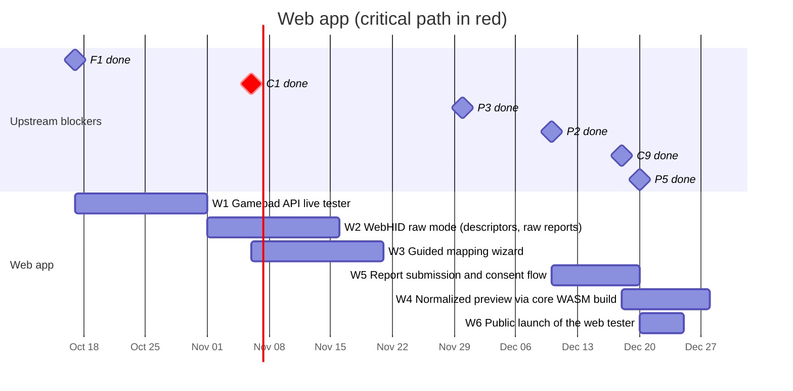

# 04 — Web app

A gamepad tester in the spirit of hardwaretester.com/gamepad that also collects
device reports. It has no dependency on the core library to get started (W1
only needs the workspace), so it can ship early and start gathering data.

## Schedule

## Tasks

| ID | Task | Days | Blocked by | Blocks | Start | End | Slack |
|----|------|-----:|------------|--------|-------|-----|------:|
| W1 | Gamepad API live tester | 15 | F1 | W2, W3, W4 | 2026-10-17 | 2026-11-01 | 30 |
| W2 | WebHID raw mode (descriptors, raw reports) | 15 | W1 | - | 2026-11-01 | 2026-11-16 | 65 |
| W3 | Guided mapping wizard | 15 | W1, C1 | W5, A3 | 2026-11-06 | 2026-11-21 | 25 |
| W4 | Normalized preview via core WASM build | 10 | W1, C9 | - | 2026-12-18 | 2026-12-28 | 23 |
| W5 | Report submission and consent flow | 10 | W3, P2, P3 | W6 | 2026-12-10 | 2026-12-20 | 26 |
| W6 | Public launch of the web tester | 5 | W5, P5 | M2 | 2026-12-20 | 2026-12-25 | 26 |

### W1 — Gamepad API live tester

Live view of buttons and axes for every connected pad, raw `id` string,
`mapping` value, timestamps/polling rate, vibration test via
`vibrationActuator`. Works on Chromium, Firefox and Safari.

### W2 — WebHID raw mode

Chromium-only opt-in mode (requires a user gesture) that reads VID/PID, HID
report descriptors and raw input reports — the same data the desktop collector
gets, without installing anything.

### W3 — Guided mapping wizard

"Press the bottom face button", "Move the left stick up", ... records what the
user confirms, producing a user-verified mapping expressed in canonical model
terms (C1).

### W4 — Normalized preview via core WASM build

Run the mapping engine compiled to WASM (C9) to show how rustpad would
normalize the connected pad, and highlight where it disagrees with what the
user confirmed in the wizard.

### W5 — Report submission and consent flow

Preview exactly what will be sent, explicit consent (P3), submit to the
ingestion API (P2).

### W6 — Public launch

Production deployment on the hosting from P5. Reaching this milestone (M2)
starts the data collection loop.
