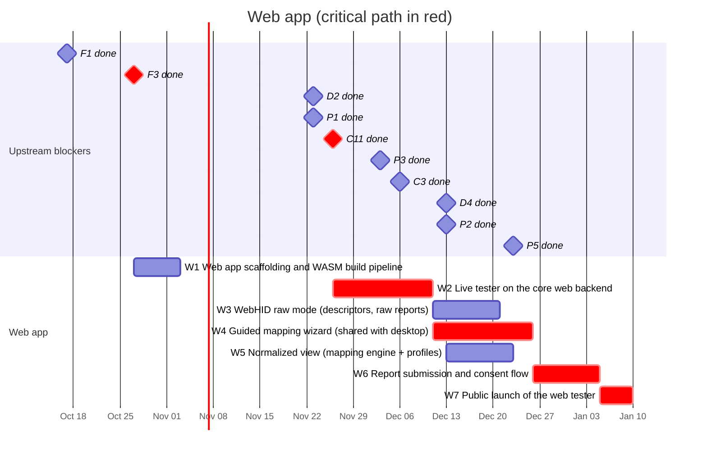

# 04 — Web app

A gamepad tester in the spirit of hardwaretester.com/gamepad that also collects
device reports. **Top priority of the project**: its launch (M2) gates the
desktop app.

**The web app runs the anygamepad Rust library compiled to WebAssembly.** All
device access (Gamepad API, WebHID), normalization, profile matching and report
building happen inside the library; the web frontend only renders state and
handles user interaction. This makes the web app a real consumer of the
library: what users see in the browser is exactly what a Rust game would get.

**Hosting:** the web app is a static site published on GitHub Pages at
<https://anygamepad.github.io> (the user/organization site served by this
repository). Only the ingestion API (P2) needs a server (P5).

## Schedule

## Tasks

| ID | Task | Days | Blocked by | Blocks | Start | End | Slack |
|----|------|-----:|------------|--------|-------|-----|------:|
| W1 | Web app scaffolding and WASM build pipeline | 7 | F1, F3 | W2 | 2026-10-27 | 2026-11-03 | 23 |
| W2 | **Live tester on the core web backend** | 15 | W1, C11 | W3, W4, W5 | 2026-11-26 | 2026-12-11 | 0 |
| W3 | WebHID raw mode (descriptors, raw reports) | 10 | W2 | - | 2026-12-11 | 2026-12-21 | 85 |
| W4 | **Guided mapping wizard (shared with desktop)** | 15 | W2 | W6, A3 | 2026-12-11 | 2026-12-26 | 0 |
| W5 | Normalized view (mapping engine + profiles) | 10 | W2, C3, D2, D4 | W7 | 2026-12-13 | 2026-12-23 | 13 |
| W6 | **Report submission and consent flow** | 10 | W4, P1, P2, P3 | W7 | 2026-12-26 | 2027-01-05 | 0 |
| W7 | **Public launch of the web tester** | 5 | W5, W6, P5 | M2 | 2027-01-05 | 2027-01-10 | 0 |

### W1 — Web app scaffolding and WASM build pipeline

Frontend project (Vite + TypeScript + jq79, see
[ADR 0005](../../docs/adr/0005-web-stack.md)), build pipeline that compiles the
library's JS bindings crate (`anygamepad-wasm`) with `wasm-bindgen`, preview
deployments from CI, bundle size budget for the `.wasm` file. Deployment to
GitHub Pages through a GitHub Actions workflow that publishes only the built
`apps/web` output (not the repository contents).

### W2 — Live tester on the core web backend

Live view of buttons and axes for every connected pad, driven by the library's
web backend (C11): browser `id` string, browser `mapping` value, raw values,
polling rate, vibration test. Must work on Chromium, Firefox and Safari.

### W3 — WebHID raw mode

Chromium-only opt-in mode (requires a user gesture) that uses the library's
WebHID access to read VID/PID, HID report descriptors and raw input reports —
the same data the desktop collector gets, without installing anything. Because
the native protocol drivers (C7) are transport-agnostic, they can later run
over WebHID too (e.g. full DualSense or Switch Pro reports in the browser).

### W4 — Guided mapping wizard

"Press the bottom face button", "Move the left stick up", ... records what the
user confirms and produces a user-verified mapping in canonical model terms
(C1). The wizard's state machine lives in the library so the desktop collection
mode (A3) reuses the same logic; the web app only provides the UI.

### W5 — Normalized view

Show the canonical output produced by the mapping engine (C3) and the embedded
profiles (D4, bootstrapped with the SDL GameControllerDB import D2) next to the
raw values, and highlight where it disagrees with what the user confirmed in
the wizard.

### W6 — Report submission and consent flow

The library builds the device report (P1) inside WASM, so web and desktop
reports come from the same code. Preview exactly what will be sent, explicit
consent (P3), submit to the ingestion API (P2).

### W7 — Public launch

Production deployment of the web app on GitHub Pages
(<https://anygamepad.github.io>), talking to the ingestion API hosted in P5. Reaching this milestone (M2)
starts the data collection loop.
