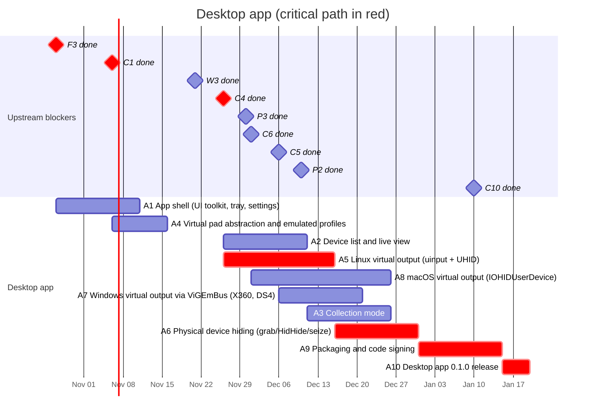

# 05 — Desktop app

Windows, Linux and macOS application that detects controllers with the core
library, offers a **virtual controller** of a selectable type (like
DS4Windows, but not limited to one target type or one OS), and has a
**collection mode** that submits device reports.

## Schedule

## Tasks

| ID | Task | Days | Blocked by | Blocks | Start | End | Slack |
|----|------|-----:|------------|--------|-------|-----|------:|
| A1 | App shell (UI toolkit, tray, settings) | 15 | F3 | A2 | 2026-10-27 | 2026-11-11 | 20 |
| A2 | Device list and live view | 15 | A1, C4 | A3 | 2026-11-26 | 2026-12-11 | 5 |
| A3 | Collection mode | 15 | A2, W3, P2, P3 | A9 | 2026-12-11 | 2026-12-26 | 5 |
| A4 | Virtual pad abstraction and emulated profiles | 10 | C1 | A5, A7, A8 | 2026-11-06 | 2026-11-16 | 10 |
| A5 | **Linux virtual output (uinput + UHID)** | 20 | A4, C4 | A6 | 2026-11-26 | 2026-12-16 | 0 |
| A6 | **Physical device hiding (grab/HidHide/seize)** | 15 | A5, C5, C6 | A9 | 2026-12-16 | 2026-12-31 | 0 |
| A7 | Windows virtual output via ViGEmBus (X360, DS4) | 15 | A4, C5 | A9 | 2026-12-06 | 2026-12-21 | 10 |
| A8 | macOS virtual output (IOHIDUserDevice) | 25 | A4, C6 | A9 | 2026-12-01 | 2026-12-26 | 5 |
| A9 | **Packaging and code signing** | 15 | A3, A6, A7, A8 | A10 | 2026-12-31 | 2027-01-15 | 0 |
| A10 | **Desktop app 0.1.0 release** | 5 | A9, C10 | M4 | 2027-01-15 | 2027-01-20 | 0 |

### A1 — App shell

UI toolkit chosen in F3, system tray, settings persistence, logging, update
check.

### A2 — Device list and live view

List detected devices with identity (C2), detected mode/profile, live
canonical input, and raw input side by side. Linux first, Windows and macOS as
their backends (C5, C6) land.

### A3 — Collection mode

Reuses the guided wizard flow (W3) and the report schema (P1). Adds data the
browser cannot see: OS driver in use, full HID descriptors on every OS,
evdev capabilities on Linux. Submits with explicit consent (P3) to the API (P2).

### A4 — Virtual pad abstraction and emulated profiles

A `VirtualPad` trait and emulated device definitions (Xbox 360, DualShock 4,
DualSense, Switch Pro Controller), each with its identity, HID descriptor and
canonical-to-output mapping.

### A5 — Linux virtual output

- `uinput` for a generic Xbox 360-style evdev pad.
- `UHID` for exact HID emulation (DualShock 4, DualSense, Switch Pro
  Controller) so the kernel's own drivers bind to the virtual device; the app
  must answer the feature/output reports those drivers send.
- udev rules for `/dev/uinput` and `/dev/uhid` access.

### A6 — Physical device hiding

Avoid games seeing both the physical and the virtual pad: `EVIOCGRAB` on Linux,
HidHide on Windows, seizing the device with IOKit on macOS.

### A7 — Windows virtual output via ViGEmBus

Xbox 360 and DualShock 4 targets through ViGEmBus. ViGEmBus is retired; this
is the pragmatic first step, an own driver is listed under "Beyond 0.1" in the
[roadmap overview](README.md#beyond-01-not-scheduled-yet).

### A8 — macOS virtual output

`IOHIDUserDevice` (requires the `com.apple.developer.hid.virtual.device`
entitlement) or a DriverKit HID driver. Request the entitlement at the start of
the task; if not granted, macOS ships without virtual output in 0.1.

### A9 — Packaging and code signing

Windows installer (MSI/winget), Linux packages (AppImage and .deb/.rpm; note
that sandboxed formats such as Flatpak complicate `/dev/uinput` access),
signed and notarized macOS `.dmg`.

### A10 — Desktop app 0.1.0 release

Milestone M4: release builds for the three OSes.
