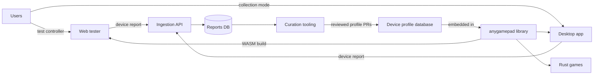
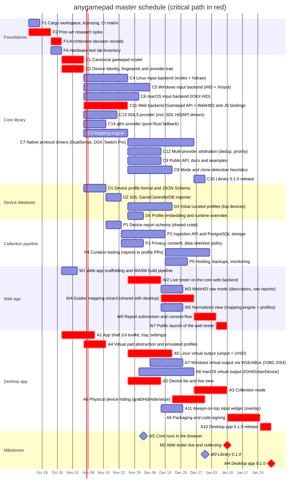
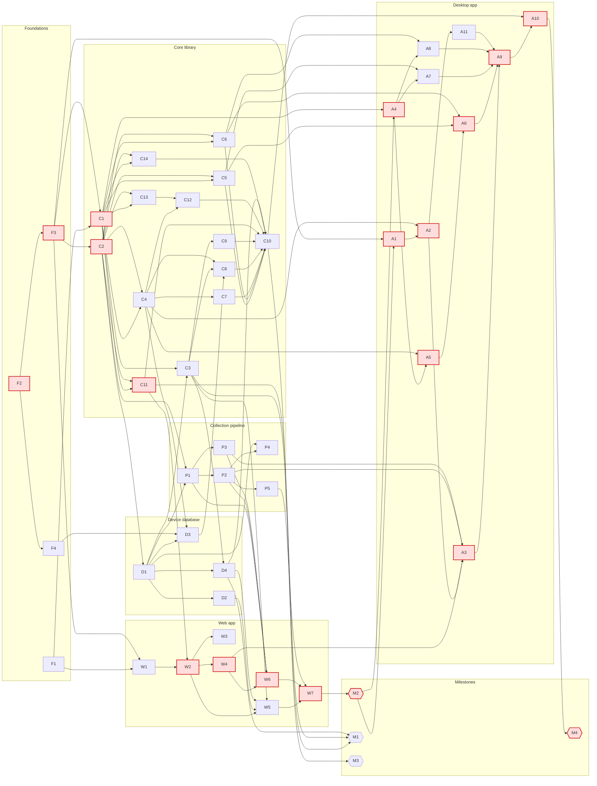

# anygamepad roadmap — 2026-10-10

Status: **active** (first roadmap of the project).

## Vision

Gamepads lie about themselves. The same physical controller can expose a
different identity and a different input layout depending on:

- **Its mode**: many controllers switch between XInput, DirectInput, Nintendo
  Switch Pro Controller, DualShock 4/DualSense emulation, vendor modes
  (GuliKit, 8BitDo, ...), each with a different VID/PID and HID report layout.
- **The host OS**: Windows (XInput/HID/GameInput), Linux (evdev nodes created by
  `xpad`, `hid-playstation`, `hid-nintendo`, generic HID), and macOS (IOKit HID,
  GameController framework) each expose the device differently.
- **The transport**: USB, Bluetooth Classic and BLE often produce different
  report formats for the same device.
- **The browser**: the Gamepad API applies its own per-browser remapping, so
  Chromium, Firefox and Safari can disagree about the same pad on the same OS.

anygamepad normalizes all of this into **one canonical gamepad model**, and builds
a data loop to keep improving detection over time.

## Deliverables

| # | Deliverable | Detail |
|---|-------------|--------|
| 1 | **Rust library** (`anygamepad` crate) that Rust games embed to get normalized gamepad input, isolating them from device/mode/OS quirks. | [01-core-library.md](01-core-library.md), [02-device-database.md](02-device-database.md) |
| 2 | **Desktop app** (Windows, Linux, macOS) that detects controllers and exposes a **virtual controller** of a selectable type (Xbox 360, DualShock 4, DualSense, Switch Pro Controller, ...), similar to DS4Windows but multi-target and multi-OS. Performance-first native UI with an **always-on-top widget**. | [05-desktop-app.md](05-desktop-app.md) |
| 3 | **Web app** similar to hardwaretester.com/gamepad, built on the **anygamepad library compiled to WebAssembly**, backed by a database that **collects reports of detected controllers**. Published on GitHub Pages at <https://anygamepad.github.io>. | [04-web-app.md](04-web-app.md), [03-collection-pipeline.md](03-collection-pipeline.md) |
| 4 | **Collection mode** in the desktop app, which gathers richer reports than the browser can (raw HID descriptors, OS driver info). | [05-desktop-app.md](05-desktop-app.md), [03-collection-pipeline.md](03-collection-pipeline.md) |

Cross-cutting groundwork lives in [00-foundations.md](00-foundations.md).

## Priorities

1. **Web app first.** The web tester (milestone M2) is the top priority: it
   starts the data collection loop and is the first real consumer of the
   library (through WebAssembly). Library work the web needs (C1, C2, C3, C11,
   D1, D2, D4) and the collection pipeline come first.
2. **Library 0.1.0** (M3): native providers (C4-C6, C13, C14) and protocol
   drivers progress in parallel, since the library is a deliverable on its own.
3. **Desktop app** (M4): its first tasks (A1, A4) are blocked by M2, so desktop
   work starts once the web tester is live, and reuses what the web built.

## Input provider strategy

To support as many gamepads as possible, the library does not pick a single
input stack: it aggregates several **providers** and arbitrates between them
per physical device (C12).

| Provider | Platforms | Why |
|----------|-----------|-----|
| Native, own (C4-C7) | Linux, Windows, macOS | Full control: modes, clones, own profiles, protocol drivers. |
| Web, own (C11) | Browser (WASM) | Gamepad API + WebHID; SDL3 does not target `wasm32-unknown-unknown`. |
| SDL3 (C13) | Linux, Windows, macOS | Widest existing coverage (SDL HIDAPI drivers + GameControllerDB). |
| gilrs (C14) | Linux, Windows, macOS | Pure-Rust fallback for games that cannot link C libraries. |

Each provider is a Cargo feature. Only one provider owns a given physical
device at a time (no duplicates, no competing handshakes); profiles can state
which provider handles a device best. In collection mode, every provider's view
of the device is recorded, so disagreements between them become data.

## The data loop

Every iteration of the project should feed collected reports back into the
curated profile database, so detection gets better with each release.

## Planning assumptions

- Schedule starts on **2026-10-12**; durations are **calendar days** of focused
  work per task.
- Core/database/collection and web workstreams are assumed to progress **in
  parallel**; the desktop workstream starts after M2 (see Priorities). With a
  single contributor the dates stretch, but the dependency graph (what blocks
  what) stays valid. Use the graph, not the dates, to decide what to pick up
  next.
- The critical path runs through the web launch (M2) and ends at milestone M4
  (desktop 0.1.0). Projected end: **2027-03-16**.

## Master schedule

Task IDs are referenced by every detailed roadmap file. `after X Y` means the
task is **blocked** until X and Y are done. Critical-path tasks are marked
`crit`.

### Critical path

Zero-slack chains (they share most tasks):

1. F2 -> F3 -> C1 -> C11 -> W2 -> W4 -> W6 -> W7 -> M2 -> A1 -> A2 -> A3 -> A9 -> A10 -> M4
2. F2 -> F3 -> C1 -> C11 -> W2 -> W4 -> W6 -> W7 -> M2 -> A4 -> A5 -> A6 -> A9 -> A10 -> M4
3. F2 -> F3 -> C2 -> C11 -> W2 -> W4 -> W6 -> W7 -> M2 -> A1 -> A2 -> A3 -> A9 -> A10 -> M4
4. F2 -> F3 -> C2 -> C11 -> W2 -> W4 -> W6 -> W7 -> M2 -> A4 -> A5 -> A6 -> A9 -> A10 -> M4

Any delay on these tasks delays the web launch (M2) and therefore the desktop
0.1.0 release. Everything else has slack (see the `Slack` column in each
detailed file).

## Dependency graph (who blocks whom)

An arrow `X --> Y` means **X blocks Y**. Red nodes are on the critical path.

## Milestones

| Milestone | Blocked by | Target date |
|-----------|------------|-------------|
| M1 Core runs in the browser | C3, C11, D4 | 2026-12-13 |
| M2 Web tester live and collecting | W7 | 2027-01-10 |
| M3 Library 0.1.0 | C10 | 2027-01-10 |
| M4 Desktop app 0.1.0 | A10 | 2027-03-16 |

## Top risks

| Risk | Impact | Mitigation |
|------|--------|------------|
| Windows virtual controller drivers: ViGEmBus is retired (no longer maintained) and only emulates Xbox 360 and DualShock 4. A custom driver needs kernel/UMDF development plus EV signing and Microsoft attestation. | No DualSense/Switch Pro emulation on Windows in 0.1. | Ship ViGEmBus-based output first (A7); investigate an own VHF/UMDF driver after 0.1 (see "Beyond 0.1"). |
| macOS virtual HID devices require the restricted `com.apple.developer.hid.virtual.device` entitlement (or DriverKit entitlements). | macOS virtual output may be blocked by Apple approval. | Request the entitlement as soon as A9 starts; ship macOS as input/collection-only if not granted. |
| Clone controllers that impersonate genuine VID/PIDs (e.g. a third-party pad in Switch mode reporting as `057e:2009`). | Wrong profile, wrong calibration, failed handshakes. | Fingerprinting beyond VID/PID (C8), community reports. |
| Privacy of collected data (serial numbers, Bluetooth MAC addresses, IPs). | Legal exposure (GDPR), loss of trust. | Strip identifiers client-side and server-side, explicit consent, retention policy (P3). |
| WebAssembly constraints: Gamepad API is poll-only (must be driven from `requestAnimationFrame`), WebHID is Chromium-only, browsers remap pads differently, and embedding profiles grows the `.wasm` bundle. | Web tester behaves differently from native, slow page load. | Browser is an identity dimension in profiles (C2, D1); bundle size budget in CI (W1); WebHID features are opt-in. |
| Hardware availability for testing many controllers on three OSes. | Profiles verified only on one OS. | Hardware lab inventory (F4) and crowd-sourced reports. |
| Project name: `rustpad` is taken on crates.io and `omnipad` is taken on GitHub, so the project and library are named `anygamepad` (free on crates.io and npm on 2026-10-10). | Someone else takes `anygamepad` before the first release. | Publish placeholder releases early (F1). |
| GitHub Pages only serves static files and does not allow custom HTTP headers (no COOP/COEP, so no `SharedArrayBuffer` or WASM threads; CSP only through a `<meta>` tag). | The ingestion API needs its own host; some WASM features unavailable. | Keep the web app single-threaded; host the API separately with CORS limited to `https://anygamepad.github.io` (P5). |
| Always-on-top widget (A11): Wayland has no standard always-on-top for regular windows, and exclusive full-screen games cover every window on all OSes. | Widget hidden in some setups. | Layer-shell where available, documented fallbacks; recommend borderless windowed mode in games. |
| Multiple providers (native, SDL3, gilrs) opening the same device: duplicates, exclusive-access conflicts, competing handshakes (e.g. two drivers configuring a Switch Pro Controller). SDL3 is also a C dependency (build and cross-compilation complexity). | Duplicate or broken input. | Arbitration layer (C12) lets one provider own each device; SDL hints disable SDL HIDAPI drivers for devices a native driver owns; SDL3 provider is an optional feature. |

## Beyond 0.1 (not scheduled yet)

- Own Windows virtual HID driver (VHF/UMDF2) to emulate DualSense and Switch Pro
  Controller; signing and attestation pipeline.
- Second data-loop iteration: use collected reports to extend the curated
  profiles and re-release the library.
- Remapping UI, per-game profiles, macros, gyro-to-mouse/stick in the desktop app.
- Bindings for other languages (C ABI, then C#/Godot/Unity) once the Rust API is
  stable.
- Steam Deck / handheld built-in controller support.

## Files in this roadmap

- [00-foundations.md](00-foundations.md)
- [01-core-library.md](01-core-library.md)
- [02-device-database.md](02-device-database.md)
- [03-collection-pipeline.md](03-collection-pipeline.md)
- [04-web-app.md](04-web-app.md)
- [05-desktop-app.md](05-desktop-app.md)
