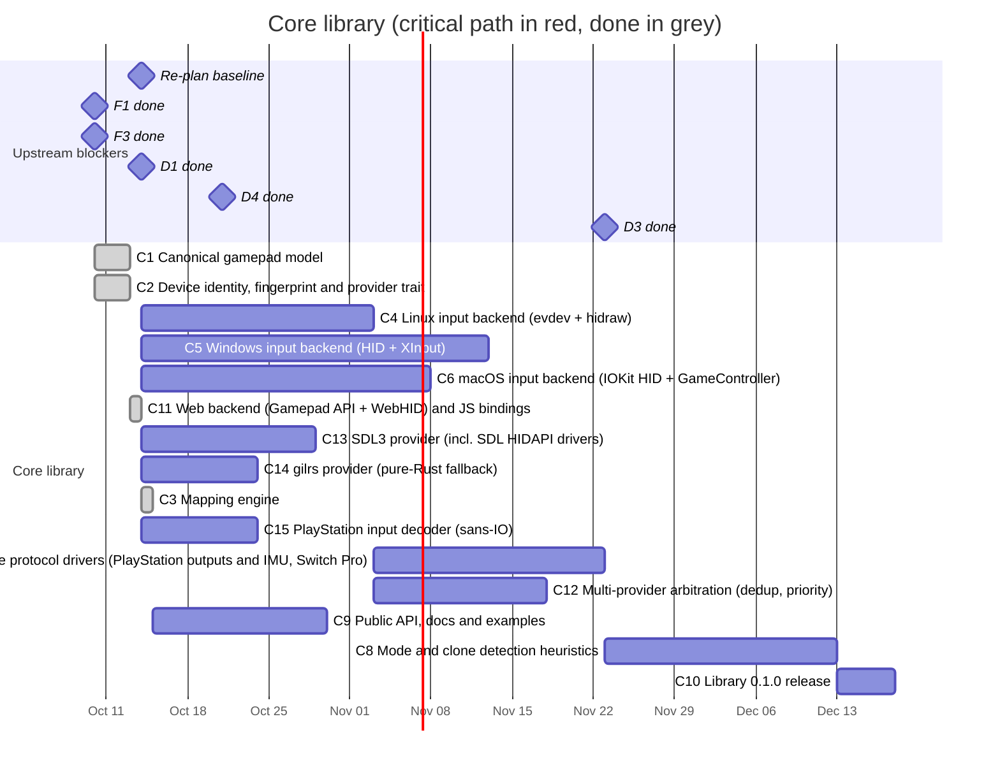

# 01 — Core library

The `anygamepad` crate: what Rust games import. It hides devices, modes, transports and OS differences behind one
canonical gamepad model.

Input comes from several **providers** (native, web, SDL3, gilrs) arbitrated
per device; see the [provider strategy](README.md#input-provider-strategy).

## Schedule

Upstream blockers from other files are shown as milestones on the date they are
expected to be done.

## Tasks

| ID | Task | Days | Blocked by | Blocks | Start | End | Slack |
|----|------|-----:|------------|--------|-------|-----|------:|
| C1 | Canonical gamepad model | 10 | F1, F3 | A4, C3, C4, C5, C6, C11, C13, C14, C15 | 2026-10-10 | 2026-10-13 | done |
| C2 | Device identity, fingerprint and provider trait | 10 | F3 | C4, C5, C6, C11, C13, C14, C15, D1, P1 | 2026-10-10 | 2026-10-13 | done |
| C3 | Mapping engine | 20 | C1, D1 | C8, C9, D4, W5, M1 | 2026-10-14 | 2026-10-14 | done |
| C4 | Linux input backend (evdev + hidraw) | 20 | C1, C2 | A2, A5, C7, C8, C12, D3 | 2026-10-14 | 2026-11-03 | 32 |
| C5 | Windows input backend (HID + XInput) | 30 | C1, C2 | A6, A7, C10 | 2026-10-14 | 2026-11-13 | 42 |
| C6 | macOS input backend (IOKit HID + GameController) | 25 | C1, C2 | A6, A8, C10 | 2026-10-14 | 2026-11-08 | 37 |
| C7 | Native protocol drivers (PlayStation outputs and IMU, Switch Pro) | 20 | C4, C15 | C10 | 2026-11-03 | 2026-11-23 | 57 |
| C8 | Mode and clone detection heuristics | 20 | C3, C4, D3 | C10 | 2026-11-23 | 2026-12-13 | 37 |
| C9 | Public API, docs and examples | 15 | C3 | C10 | 2026-10-14 | 2026-10-29 | 82 |
| C10 | Library 0.1.0 release | 5 | C5, C6, C7, C8, C9, C11, C12, C14, D4 | A10, M3 | 2026-12-13 | 2026-12-18 | 37 |
| C11 | Web backend (Gamepad API + WebHID) and JS bindings | 20 | C1, C2 | C10, W2, M1 | 2026-10-13 | 2026-10-14 | done |
| C12 | Multi-provider arbitration (dedup, priority) | 15 | C4, C13 | C10 | 2026-11-03 | 2026-11-18 | 62 |
| C13 | SDL3 provider (incl. SDL HIDAPI drivers) | 15 | C1, C2 | C12 | 2026-10-14 | 2026-10-29 | 67 |
| C14 | gilrs provider (pure-Rust fallback) | 10 | C1, C2 | C10 | 2026-10-14 | 2026-10-24 | 87 |
| C15 | PlayStation input decoder (sans-IO) | 10 | C1, C2 | C7, W3 | 2026-10-14 | 2026-10-24 | 67 |

### C1 — Canonical gamepad model

- **Positional** face buttons (`South`, `East`, `West`, `North`) so game logic
  does not depend on the label printed on the button; plus a **label/glyph**
  layer (`A/B/X/Y`, `Cross/Circle/Square/Triangle`, Nintendo `B/A/Y/X`) for UI
  prompts.
- D-pad, shoulders, triggers (analog + digital), sticks and stick clicks,
  `Start/Select/Home/Share/Capture`, back paddles, touchpad (points + click),
  motion sensors (gyro/accelerometer in SI units), battery, connection type.
- Output capabilities: rumble (including dual-motor and HD rumble as optional
  capabilities), lightbar/player LEDs, adaptive triggers (optional).
- Every feature is described by a capability set, so games can query what a
  device supports.

Status (2026-10-13): done
(`RECORD/2026-10-10.c1-canonical-gamepad-model.completed.md`).

### C2 — Device identity, fingerprint and provider trait

Identity is more than VID/PID: bus type (USB, Bluetooth, BLE), version, product
string, HID report descriptor hash, OS, OS driver that owns the device
(`xpad`, `hid-playstation`, XUSB, HID, ...), browser and its Gamepad API
`id`/`mapping` when running on the web backend (C11), and detected mode.
Shared with the device database (D1) and the report schema (P1).

Also defines the `Provider` trait every input source implements (enumerate,
hotplug, open, read raw state, output) and how a provider describes the
identity of what it sees.

Status (2026-10-13): done
(`RECORD/2026-10-10.c2-device-identity-and-provider-trait.completed.md`).

### C3 — Mapping engine

Applies a device profile to raw elements: button remap, axis
inversion/range/center calibration, combined axes (e.g. Xbox triggers on a
single HID axis in DirectInput mode), hat-to-dpad, dead zones. Pure and
deterministic so it can be unit-tested and runs unchanged in WebAssembly (C11).

Status (2026-10-14): done
(`RECORD/2026-10-14.c3-mapping-engine.completed.md`): `anygamepad::mapping`
resolves a profile's mapping against a provider's raw layout once
(`Mapper::new`) and maps every raw state without allocating
(`Mapper::apply`), with the capabilities it drives and the inputs the device
lacks. Canonical sources (XInput, gilrs) need no profile, and trigger
buttons follow their axis unless a profile maps them. Centre and range come
from the raw layout; per-device calibration is a deadzone, as D1 decided.

### C4 — Linux native provider

`evdev` for devices bound to kernel drivers and `hidraw` for devices we drive
ourselves; hotplug via udev. Document required permissions (udev rules).

### C5 — Windows native provider

Raw Input / HID for generic devices, XInput for XUSB devices (note: XInput does
not expose VID/PID, correlate with the HID/PnP device tree). Evaluate
GameInput as a future replacement.

### C6 — macOS native provider

IOKit `IOHIDManager` for generic HID devices, and the GameController
framework for the pads macOS drives itself (PlayStation, Xbox, Switch Pro,
MFi). GameController is required for the DualSense: macOS switches it to its
extended report, and IOKit then gets no input
([research note 06](../../docs/research/06-browser-gamepad-api.md#dualsense-in-chrome-on-macos-added-2026-10-14)).
A working reference on a real DualSense: `germadev/motorust`,
`src/gamepads/apple.rs` (`objc2-game-controller`).

### C7 — Native protocol drivers

Talk directly to devices over HID to unlock features hidden by generic
drivers. Drivers are **transport-agnostic** (sans-IO: they consume and produce
reports, the backend moves the bytes) so the same code runs over hidraw,
Windows HID, IOKit and WebHID:

- DualSense / DualShock 4, on top of C15's input decoding: switching
  Bluetooth pads to the full report (they start with a reduced report until a
  calibration feature report is read), IMU calibration, firmware information,
  output reports (lightbar, player LEDs, rumble, adaptive triggers) with the
  Bluetooth CRC32.
- Switch Pro Controller: handshake and subcommands to enable full report mode
  and IMU, player LEDs, rumble.

### C15 — PlayStation input decoder

The input half of the PlayStation driver, split from C7 so the web can use it
before the native backends exist. Sans-IO and free of platform code, so it
builds for `wasm32-unknown-unknown` and every native target.

- DualSense (`054c:0ce6`), DualSense Edge (`054c:0df2`) and DualShock 4
  (`054c:05c4`, `054c:09cc`) input reports to the canonical state (C1):
  buttons, sticks, triggers, touchpad points and click, raw IMU values,
  battery and charging state.
- Every report form: USB, Bluetooth reduced (`0x01`) and Bluetooth full
  (`0x31` DualSense, `0x11` DualShock 4, with its CRC32 checked). In report
  `0x31`, only state payloads are decoded (audio payloads share the ID).
- Transport from the input report sizes, for WebHID, which does not report
  the bus.
- It only parses: sending feature or output reports is C7's.
- Never decode or request factory test data (`0x80`/`0x81`): it holds serial
  numbers and the Bluetooth MAC.

Start from [research note 09](../../docs/research/09-dualsense-hid-protocol.md)
and check it against `hid-playstation`. **Done when:** tests decode recorded
reports of a real DualSense over USB and Bluetooth (recorded with W3's raw
view, without identifying data), and DualShock 4 reports from the same
sources as note 09.

Status (2026-10-14): decoder implemented with tests on built reports
(`RECORD/2026-10-14.c15-playstation-decoder.WIP.md`); waiting on recordings
from a real pad.

### C8 — Mode and clone detection heuristics

Decide which profile applies when VID/PID is ambiguous: report descriptor
fingerprints, feature-report probing, product strings, per-OS quirks. Built on
the initial curated profiles (D3).

### C9 — Public API, docs and examples

Polling and event APIs, hotplug events, capability queries, examples (minimal
game loop, Bevy integration example).

Owner direction (2026-10-14): the Bevy integration is the library's use in
`germadev/motorust`, which today reads pads through gilrs and, on macOS,
GameController (`src/gamepads.rs`, `src/gamepads/apple.rs`), feeding Bevy's
gamepad events, rumble and DualSense adaptive triggers.

### C11 — Web backend and JS bindings

The library runs in the browser as WebAssembly; the web app (04) is built on
it.

- Web input backend for `wasm32-unknown-unknown` using `web-sys`: Gamepad API
  (polled from `requestAnimationFrame`, connect/disconnect events) and WebHID
  (Chromium, opt-in, user gesture required).
- `anygamepad-wasm` crate: `wasm-bindgen` API and generated TypeScript types for
  the web frontend (device list, raw and canonical state, wizard, reports).
- Rust games compiled to WASM get the same backend for free.

Status (2026-10-13): done
(`RECORD/2026-10-13.c11-web-backend-and-js-bindings.completed.md`): Gamepad
API provider, WebHID access (raw reports, not decoded) and the `Gamepads` /
`HidDevices` bindings. Wizard and report bindings come with W4 and W6.

### C12 — Multi-provider arbitration

- Correlate devices seen by several providers into one physical device
  (VID/PID, bus, OS device path/instance ID).
- Pick the owning provider per device from profile hints and a default
  priority (native protocol driver > SDL3 HIDAPI driver > native generic >
  gilrs); the others ignore that device.
- Configure SDL hints so SDL does not grab devices a native driver owns.
- Collection mode can open every provider in observe-only mode to record how
  each one sees the device.

### C13 — SDL3 provider

Optional `sdl3` Cargo feature using SDL3 (zlib license) through Rust bindings:
gamepad and joystick APIs, SDL HIDAPI drivers, GameControllerDB mappings,
sensors, rumble, LEDs. Decide static vs dynamic linking and document the build
requirements.

### C14 — gilrs provider

Optional `gilrs` Cargo feature: pure-Rust fallback for games that cannot link
C libraries.

### C10 — Library 0.1.0 release

Publish to crates.io; semver policy; changelog.

**Done when:** a sample game reads the same canonical input from at least one
Xbox, one PlayStation and one Switch-style controller on Linux, Windows,
macOS and in the browser (Chromium and Firefox) through WebAssembly.
