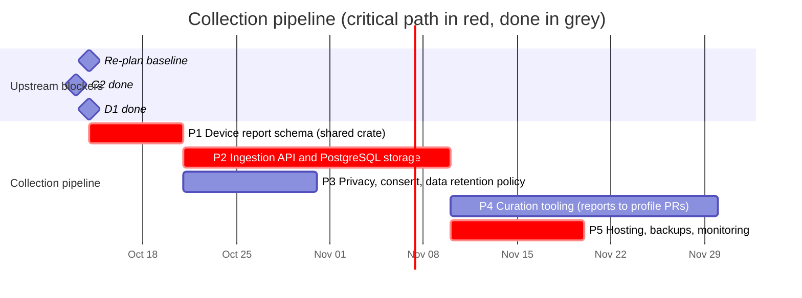

# 03 — Collection pipeline

Backend that receives device reports from the web app and the desktop app,
stores them, and turns them into curated profile updates.

## Schedule

## Tasks

| ID | Task | Days | Blocked by | Blocks | Start | End | Slack |
|----|------|-----:|------------|--------|-------|-----|------:|
| P1 | **Device report schema (shared crate)** | 7 | C2, D1 | P2, P3, W6 | 2026-10-14 | 2026-10-21 | 0 |
| P2 | **Ingestion API and PostgreSQL storage** | 20 | P1 | A3, P4, P5, W6 | 2026-10-21 | 2026-11-10 | 0 |
| P3 | Privacy, consent, data retention policy | 10 | P1 | A3, W6 | 2026-10-21 | 2026-10-31 | 10 |
| P4 | Curation tooling (reports to profile PRs) | 20 | P2, D1 | - | 2026-11-10 | 2026-11-30 | 60 |
| P5 | **Hosting, backups, monitoring** | 10 | P2 | W7 | 2026-11-10 | 2026-11-20 | 0 |

### P1 — Device report schema

Shared crate `anygamepad-report` (plus generated JSON Schema) describing a
report. The web app builds reports with this same crate running in WebAssembly
(TypeScript types come from the `anygamepad-wasm` bindings, C11), so web and
desktop reports are produced by identical code:

- Source (web or desktop), app/browser version, OS and version.
- Identity fields (C2): VID/PID, version, bus, names as reported by each API
  (e.g. the browser Gamepad `id` string, which differs between browsers).
- Per-provider view (desktop): how native, SDL3 and gilrs each see the device
  (C12).
- Raw data when available: HID report descriptor, sample input reports,
  button/axis counts, browser `mapping` value.
- User-confirmed mapping from the guided wizard (W4) and the mode the user says
  the controller is in.
- **Never** serial numbers, Bluetooth MAC addresses or any personal data:
  stripped on the client and validated again on the server.

### P2 — Ingestion API and PostgreSQL storage

Rust `axum` service (shares types with the library), PostgreSQL storage
([ADR 0006](../../docs/adr/0006-server-stack.md)),
schema validation, deduplication by fingerprint, rate limiting, and an
anonymous submission token.

### P3 — Privacy, consent, data retention

Privacy policy, explicit consent screen text, retention periods, GDPR data
handling (no IP addresses stored beyond rate limiting), public data license for
the aggregated dataset.

### P4 — Curation tooling

Aggregate reports per fingerprint, show disagreements between reports, and
generate profile PRs for `data/profiles/` that a maintainer reviews.

### P5 — Hosting, backups, monitoring

Deployment target for the ingestion API and PostgreSQL (the web frontend is
static and lives on GitHub Pages, see W7), automated backups, uptime and error
monitoring. CORS allows the `https://anygamepad.github.io` origin.
