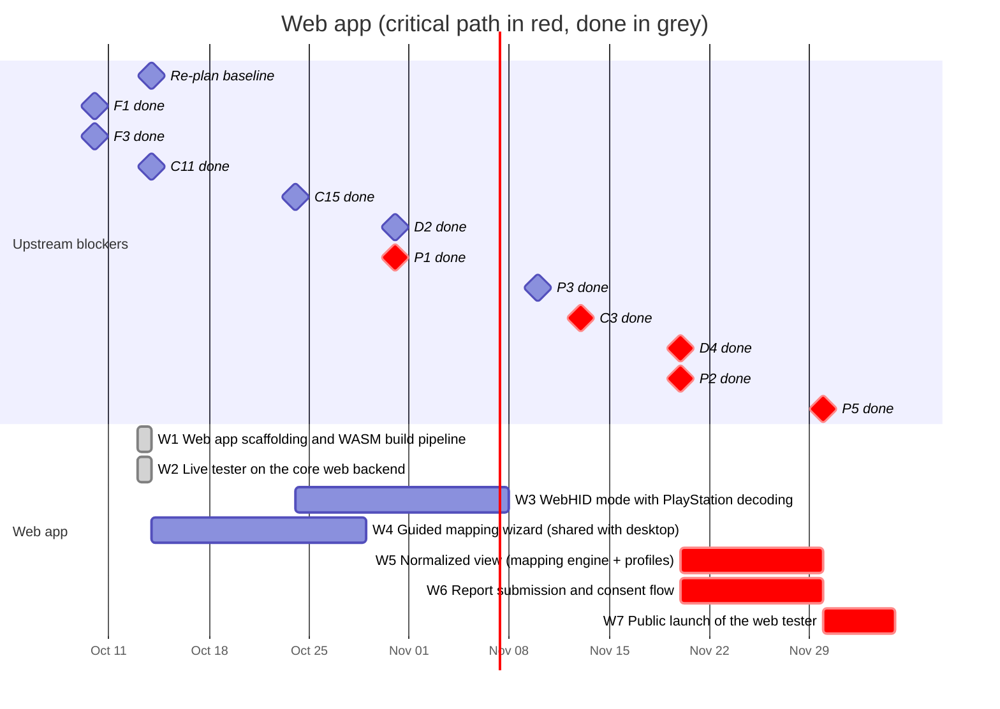

# 04 — Web app

A gamepad tester in the spirit of hardwaretester.com/gamepad that also collects
device reports. **Top priority of the project**: its launch (M2) gates the
desktop app.

**The web app runs the anygamepad Rust library compiled to WebAssembly.** All
device access (Gamepad API, WebHID), normalization, profile matching and report
building happen inside the library; the web frontend only renders state and
handles user interaction. This makes the web app a real consumer of the
library: what users see in the browser is exactly what a Rust game would get.

**Hosting:** the web app is a static site published on GitHub Pages at
<https://anygamepad.github.io> (the user/organization site served by this
repository). Only the ingestion API (P2) needs a server (P5).

## Schedule

## Tasks

| ID | Task | Days | Blocked by | Blocks | Start | End | Slack |
|----|------|-----:|------------|--------|-------|-----|------:|
| W1 | Web app scaffolding and WASM build pipeline | 7 | F1, F3 | W2 | 2026-10-13 | 2026-10-14 | done |
| W2 | Live tester on the core web backend | 15 | W1, C11 | W3, W4, W5 | 2026-10-13 | 2026-10-14 | done |
| W3 | WebHID mode with PlayStation decoding | 15 | W2, C15 | - | 2026-10-24 | 2026-11-08 | 92 |
| W4 | Guided mapping wizard (shared with desktop) | 15 | W2 | A3, W6 | 2026-10-14 | 2026-10-29 | 22 |
| W5 | **Normalized view (mapping engine + profiles)** | 10 | W2, C3, D2, D4 | W7 | 2026-11-20 | 2026-11-30 | 0 |
| W6 | **Report submission and consent flow** | 10 | W4, P1, P2, P3 | W7 | 2026-11-20 | 2026-11-30 | 0 |
| W7 | **Public launch of the web tester** | 5 | W5, W6, P5 | M2 | 2026-11-30 | 2026-12-05 | 0 |

### W1 — Web app scaffolding and WASM build pipeline

Frontend project (Vite + TypeScript + jq79, see
[ADR 0005](../../docs/adr/0005-web-stack.md)), build pipeline that compiles the
library's JS bindings crate (`anygamepad-wasm`) with `wasm-bindgen`, preview
deployments from CI, bundle size budget for the `.wasm` file. Deployment to
GitHub Pages through a GitHub Actions workflow that publishes only the built
`apps/web` output (not the repository contents).

Status (2026-10-13): done
(`RECORD/2026-10-13.w1-web-scaffolding.completed.md`). Previews are build
artifacts, not hosted sites (GitHub Pages hosts one site per repository).

### W2 — Live tester on the core web backend

Live view of buttons and axes for every connected pad, driven by the library's
web backend (C11): browser `id` string, browser `mapping` value, raw values,
polling rate, vibration test. Must work on Chromium, Firefox and Safari.

Status (2026-10-13): done
(`RECORD/2026-10-13.w2-live-tester.completed.md`). Tested with fake gamepads
in Chromium, Firefox and WebKit (CI); real gamepads and Safari itself are
not yet verified.

Status (2026-10-14): first real-device test. The owner's DualSense does not
show in Chrome on macOS (macOS switches it to its extended report, see the
[README](README.md#changes-from-2026-10-10)); the tester now explains this to
Chromium users on macOS while no gamepad shows
(`RECORD/2026-10-14.chromium-macos-dualsense-hint.completed.md`).

### W3 — WebHID mode with PlayStation decoding

Chromium-only opt-in mode (requires a user gesture and the browser's device
chooser) on the library's WebHID access (C11):

- **Raw view** for any HID game controller: VID/PID, report descriptors
  (collections) and live raw input reports — the same data the desktop
  collector gets, without installing anything.
- **Decoded view** for PlayStation pads, through C15: the same live card as
  the Gamepad API pads (drawing, canonical names, update rate), plus what the
  Gamepad API lacks (touchpad points, raw IMU, battery). This is how a
  DualSense shows in Chromium on macOS.
- **One card per pad**: a pad open through WebHID hides its Gamepad API twin
  (same VID/PID).
- **Report modes**: reading feature reports switches a Bluetooth pad to its
  full report for every application until it is power-cycled, so W3 reads
  them only after telling the user (on macOS the system has already switched
  it). It reads firmware information (`0x20`) and calibration only.
- **Privacy**: no factory test commands, no pairing report (it holds the
  Bluetooth MAC), no serial number (AGENTS.md).
- The macOS hint of W2 points to this mode once it exists.

**Done when:** the owner's DualSense shows, decoded and live, in Chrome on
macOS over USB and Bluetooth; the raw view works for a non-PlayStation pad;
the smoke test covers both views with fake `HIDDevice`s.

### W4 — Guided mapping wizard

"Press the bottom face button", "Move the left stick up", ... records what the
user confirms and produces a user-verified mapping in canonical model terms
(C1). The wizard's state machine lives in the library so the desktop collection
mode (A3) reuses the same logic; the web app only provides the UI.

### W5 — Normalized view

Show the canonical output produced by the mapping engine (C3) and the embedded
profiles (D4, bootstrapped with the SDL GameControllerDB import D2) next to the
raw values, and highlight where it disagrees with what the user confirmed in
the wizard.

### W6 — Report submission and consent flow

The library builds the device report (P1) inside WASM, so web and desktop
reports come from the same code. Preview exactly what will be sent, explicit
consent (P3), submit to the ingestion API (P2).

### W7 — Public launch

Production deployment of the web app on GitHub Pages
(<https://anygamepad.github.io>), talking to the ingestion API hosted in P5. Reaching this milestone (M2)
starts the data collection loop.
