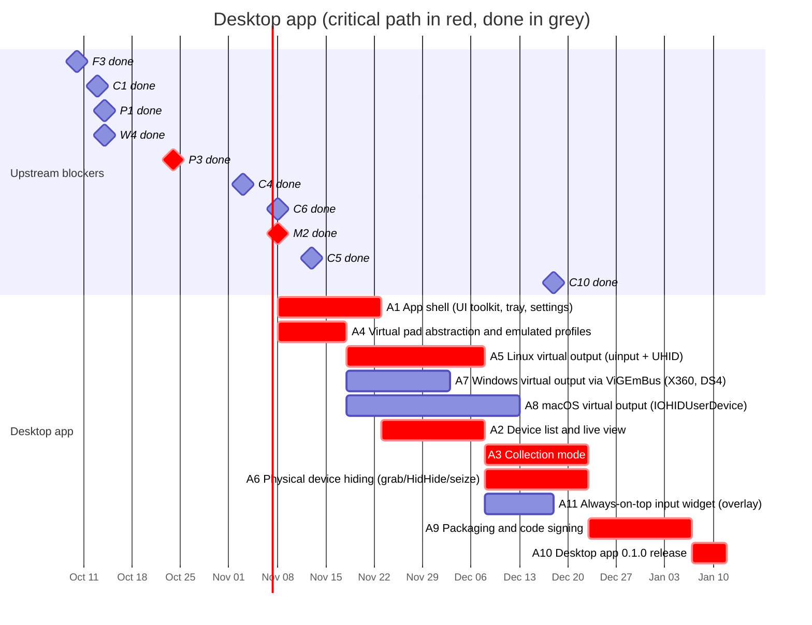

# 05 — Desktop app

Windows, Linux and macOS application that detects controllers with the core
library, offers a **virtual controller** of a selectable type (like
DS4Windows, but not limited to one target type or one OS), and has a
**collection mode** that writes device reports to files
([ADR 0007](../../docs/adr/0007-local-first-device-reports.md)).

The web app has priority: the desktop workstream starts after the web tester
is live (M2).

UI requirements: **performance first** and an **always-on-top widget**. The
recommended toolkit is egui (see ADR 4 in
[00-foundations.md](00-foundations.md#f3--architecture-decision-records)).

## Schedule

## Tasks

| ID | Task | Days | Blocked by | Blocks | Start | End | Slack |
|----|------|-----:|------------|--------|-------|-----|------:|
| A1 | **App shell (UI toolkit, tray, settings)** | 15 | F3, M2 | A2 | 2026-11-08 | 2026-11-23 | 0 |
| A2 | **Device list and live view** | 15 | A1, C4 | A3, A11 | 2026-11-23 | 2026-12-08 | 0 |
| A3 | **Collection mode** | 15 | A2, W4, P1, P3 | A9, P6 | 2026-12-08 | 2026-12-23 | 0 |
| A4 | **Virtual pad abstraction and emulated profiles** | 10 | C1, M2 | A5, A7, A8 | 2026-11-08 | 2026-11-18 | 0 |
| A5 | **Linux virtual output (uinput + UHID)** | 20 | A4, C4 | A6 | 2026-11-18 | 2026-12-08 | 0 |
| A6 | **Physical device hiding (grab/HidHide/seize)** | 15 | A5, C5, C6 | A9 | 2026-12-08 | 2026-12-23 | 0 |
| A7 | Windows virtual output via ViGEmBus (X360, DS4) | 15 | A4, C5 | A9 | 2026-11-18 | 2026-12-03 | 20 |
| A8 | macOS virtual output (IOHIDUserDevice) | 25 | A4, C6 | A9 | 2026-11-18 | 2026-12-13 | 10 |
| A9 | **Packaging and code signing** | 15 | A3, A6, A7, A8, A11 | A10 | 2026-12-23 | 2027-01-07 | 0 |
| A10 | **Desktop app 0.1.0 release** | 5 | A9, C10 | M4 | 2027-01-07 | 2027-01-12 | 0 |
| A11 | Always-on-top input widget (overlay) | 10 | A2 | A9 | 2026-12-08 | 2026-12-18 | 5 |

### A1 — App shell

UI toolkit chosen in F3 ([ADR 0004](../../docs/adr/0004-desktop-ui-toolkit.md),
accepted once its prototype meets the targets), system tray, settings
persistence, logging, update check. Performance budget: repaint only when
input or state changes, near-zero CPU when idle, input-to-pixel latency of at
most one frame.

### A2 — Device list and live view

List detected devices with identity (C2), detected mode/profile, live
canonical input, and raw input side by side. Linux first, Windows and macOS as
their backends (C5, C6) land.

### A3 — Collection mode

Reuses the guided wizard logic from the library (W4) and the report schema (P1). Adds data the
browser cannot see: OS driver in use, full HID descriptors on every OS,
evdev capabilities on Linux. Writes one report file per device to the app's
data directory, and shares a report through the same GitHub issue form as
the web app after showing it, with explicit consent (P3); see
[ADR 0007](../../docs/adr/0007-local-first-device-reports.md). Upload to
the sync server comes with P6.

### A4 — Virtual pad abstraction and emulated profiles

A `VirtualPad` trait and emulated device definitions (Xbox 360, DualShock 4,
DualSense, Switch Pro Controller), each with its identity, HID descriptor and
canonical-to-output mapping.

### A5 — Linux virtual output

- `uinput` for a generic Xbox 360-style evdev pad.
- `UHID` for exact HID emulation (DualShock 4, DualSense, Switch Pro
  Controller) so the kernel's own drivers bind to the virtual device; the app
  must answer the feature/output reports those drivers send.
- udev rules for `/dev/uinput` and `/dev/uhid` access.

### A6 — Physical device hiding

Avoid games seeing both the physical and the virtual pad: `EVIOCGRAB` on Linux,
HidHide on Windows, seizing the device with IOKit on macOS.

### A7 — Windows virtual output via ViGEmBus

Xbox 360 and DualShock 4 targets through ViGEmBus. ViGEmBus is retired; this
is the pragmatic first step, an own driver is listed under "Beyond 0.1" in the
[roadmap overview](README.md#beyond-01-not-scheduled-yet).

### A8 — macOS virtual output

`IOHIDUserDevice` (requires the `com.apple.developer.hid.virtual.device`
entitlement) or a DriverKit HID driver. Request the entitlement at the start of
the task; if not granted, macOS ships without virtual output in 0.1.

### A9 — Packaging and code signing

Windows installer (MSI/winget), Linux packages (AppImage and .deb/.rpm; note
that sandboxed formats such as Flatpak complicate `/dev/uinput` access),
signed and notarized macOS `.dmg`.

### A10 — Desktop app 0.1.0 release

Milestone M4: release builds for the three OSes.

### A11 — Always-on-top input widget

A small, separate window that stays above other windows and shows live
controller state (e.g. for streaming, testing or checking battery): borderless,
optionally transparent and click-through, resizable, with selectable devices
and skins. Platform limits to handle and document:

- Wayland: regular clients cannot force always-on-top; use the layer-shell
  protocol where the compositor supports it (wlroots-based, KDE), fall back to
  XWayland or user-set "always on top" on GNOME.
- macOS: floating window level plus collection behaviour to stay visible on all
  Spaces and over full-screen apps.
- Windows and all OSes: games in exclusive full-screen mode cover any window;
  only borderless/windowed games show the widget.
