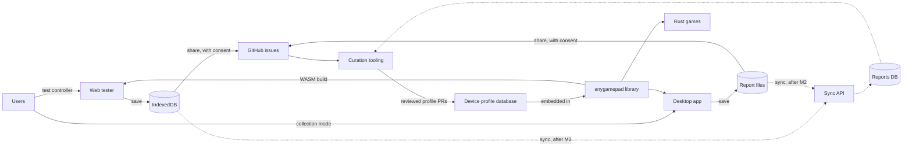
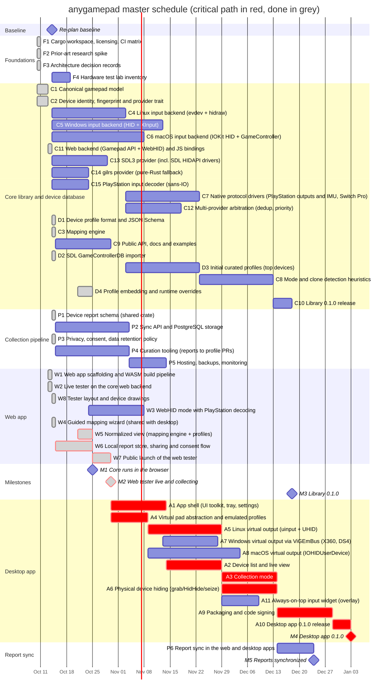
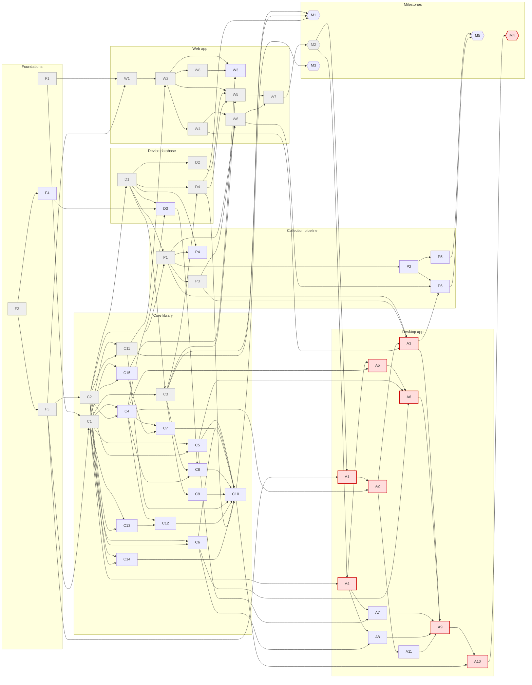

# anygamepad roadmap — 2026-10-14

Status: **active**. Supersedes [ROADMAP/2026-10-10/](../2026-10-10/README.md).

## Changes from 2026-10-10

The first test with a real controller failed: the owner's DualSense does not
show in the live tester (W2) in Chrome on macOS, while the same pad works
natively through Apple's GameController framework. macOS switches the
DualSense to its extended report, which Chromium's HID reader cannot decode,
so the Gamepad API never exposes it
([research note 06](../../docs/research/06-browser-gamepad-api.md#dualsense-in-chrome-on-macos-added-2026-10-14)).
WebHID can read that report ([research note 09](../../docs/research/09-dualsense-hid-protocol.md)).

- **New C15**, PlayStation input decoder (sans-IO): DualSense, DualSense Edge
  and DualShock 4 input reports to canonical state. It needs only C1 and C2,
  both done, so it can start now.
- **W3** becomes "WebHID mode with PlayStation decoding": blocked by C15
  and W8 as well as W2, 15 days instead of 10. It makes PlayStation pads that
  the Gamepad API misses show in Chromium.
- **New W8**, tester layout and device drawings (added the same day): a
  two-column page in the spirit of `ds.daidr.me`, with the selected pad drawn
  large, one drawing per family (DualShock 3 and 4, DualSense, Switch Pro,
  Xbox, and a generic one after the Flydigi Vader 5 Pro), and the raw values
  folded away. W3's touchpad, motion and battery panels go into it.
- **C7** keeps what C15 does not cover (outputs, IMU calibration, feature
  reports, Switch Pro), is blocked by C15 as well as C4, and drops from 30 to
  20 days.
- **C6** reads the pads macOS drives itself through GameController, which is
  required for the DualSense, not only worth evaluating.
- **Re-baselined on 2026-10-14.** F1-F3, C1, C2, C11, W1 and W2 are done
  (grey, with their actual dates). Everything else is scheduled from the
  baseline milestone `t0`.
- **Owner direction (2026-10-14), not yet re-planned:** the owner will
  integrate the library into `germadev/motorust` (Bevy 0.19; Linux,
  Windows, macOS and the web) as its gamepad layer, besides the native and
  web apps. motorust becomes the library's first consumer: C9's Bevy
  example becomes that integration, and motorust's own gamepad code (gilrs,
  plus GameController on macOS for the DualSense, rumble and adaptive
  triggers) is what C6, C7, C14 and C9 must replace without losing
  anything. Not urgent (owner, same day): controller support comes first,
  so the schedule stays as it is.
- **Owner direction (2026-10-14), re-planned the same day (last item):**
  the desktop binaries write device reports to files, and the web app keeps
  them in IndexedDB, synchronized with a database later. This changes the
  collection pipeline (P2, P5, W6, A3): the server, now on the critical path
  to M2, may move after it. It needs an ADR and a re-plan.
- **Owner decision (2026-10-14): W8, C15 and W3 are next.** Reason: the
  most common controller on the owner's own setup does not work in the
  tester, and every later web task (W4 included) is tested with it. All three
  have slack, but D1 is now on the critical path: with one contributor, every
  day spent on them first moves M2 by a day.
- **Status update (2026-10-14, in place):** W8, D1 and D2 are done (grey).
  D1 left the critical path ten days early, so the dates move ten days
  earlier: M1 on 2026-11-10, M2 on 2026-11-25, M4 on 2027-01-29.
- **Status update (2026-10-14, in place):** C3 is done (grey). C3, D4 and
  W5 leave the critical path, and M1 moves to 2026-10-21. M2 and M4 stay:
  the collection pipeline (P1 -> P2) is now the only path to M2.
- **Re-plan (2026-10-14, in place): local-first reports**
  ([ADR 0007](../../docs/adr/0007-local-first-device-reports.md)). P1 is
  done (grey). Reports stay local (files on the desktop, IndexedDB in the
  browser) and people share the ones they choose as GitHub issues until a
  sync server exists. Owner decisions of the same day: M2 needs local
  reports and sharing, not the server; issues are the sharing channel.
  - W6 becomes "Local report store, sharing and consent flow", blocked by
    W4, P1 and P3 (no longer P2); W7 no longer waits for P5; A3 writes files
    and waits for P1 instead of P2; P4 reads issues and files, blocked by P1
    and D1.
  - P2 becomes the sync API. New P6 (report sync in the web and desktop
    apps, after P2, W6 and A3) and milestone M5 (reports synchronized,
    after P5 and P6).
  - The critical path to M2 is now W4 -> W6 -> W7: M2 moves from
    2026-11-25 to 2026-11-13, M4 from 2027-01-29 to 2027-01-17. M5 lands on
    2027-01-07 with 10 days of slack; P3 has 5.
- **Status update (2026-10-14, in place):** W4, the guided mapping wizard,
  is done (grey), with the owner's request that a button combination on
  the pad say it lacks the control asked for. The critical path to M2 is
  now P3 -> W6 -> W7: M2 moves to 2026-11-08, M4 to 2027-01-12, M5 to
  2027-01-02 (slack 10). D4 and W5 have 3 days of slack.
- **Status update (2026-10-14, in place):** P3, privacy, consent and
  retention, is done (grey): the policy at
  <https://anygamepad.github.io/privacy/> and its maintainer side in
  [`docs/privacy/`](../../docs/privacy/README.md), with the owner's
  decisions of the same day (reports under CC0 1.0, this repository's
  issues as the only contact, curated report issues closed and kept). The
  critical path to M2 is now D4 -> W5 -> W7: M2 moves to 2026-11-05, M4 to
  2027-01-09, M5 to 2026-12-30 (slack 10). W6 has 7 days of slack.
- **Status update (2026-10-25, in place):** D4, embedded device database
  (curated + SDL), W5, normalized view, W6, local report store, sharing
  and consent flow, and W7, public launch of the web tester, are done (grey).
  Milestone M2 is reached. The critical path now runs through the desktop
  app tracks (M2 -> A1/A4 ... -> M4), with M4 on 2026-12-29 and M5 on 2026-12-24.

## Vision

Gamepads lie about themselves. The same physical controller can expose a
different identity and a different input layout depending on:

- **Its mode**: many controllers switch between XInput, DirectInput, Nintendo
  Switch Pro Controller, DualShock 4/DualSense emulation, vendor modes
  (GuliKit, 8BitDo, ...), each with a different VID/PID and HID report layout.
- **The host OS**: Windows (XInput/HID/GameInput), Linux (evdev nodes created by
  `xpad`, `hid-playstation`, `hid-nintendo`, generic HID), and macOS (IOKit HID,
  GameController framework) each expose the device differently.
- **The transport**: USB, Bluetooth Classic and BLE often produce different
  report formats for the same device.
- **The browser**: the Gamepad API applies its own per-browser remapping, so
  Chromium, Firefox and Safari can disagree about the same pad on the same OS.

anygamepad normalizes all of this into **one canonical gamepad model**, and builds
a data loop to keep improving detection over time.

## Deliverables

| # | Deliverable | Detail |
|---|-------------|--------|
| 1 | **Rust library** (`anygamepad` crate) that Rust games embed to get normalized gamepad input, isolating them from device/mode/OS quirks. | [01-core-library.md](01-core-library.md), [02-device-database.md](02-device-database.md) |
| 2 | **Desktop app** (Windows, Linux, macOS) that detects controllers and exposes a **virtual controller** of a selectable type (Xbox 360, DualShock 4, DualSense, Switch Pro Controller, ...), similar to DS4Windows but multi-target and multi-OS. Performance-first native UI with an **always-on-top widget**. | [05-desktop-app.md](05-desktop-app.md) |
| 3 | **Web app** similar to hardwaretester.com/gamepad, built on the **anygamepad library compiled to WebAssembly**, that **collects reports of detected controllers** (kept locally and shared as GitHub issues first, synchronized with a database later; [ADR 0007](../../docs/adr/0007-local-first-device-reports.md)). Published on GitHub Pages at <https://anygamepad.github.io>. | [04-web-app.md](04-web-app.md), [03-collection-pipeline.md](03-collection-pipeline.md) |
| 4 | **Collection mode** in the desktop app, which gathers richer reports than the browser can (raw HID descriptors, OS driver info). | [05-desktop-app.md](05-desktop-app.md), [03-collection-pipeline.md](03-collection-pipeline.md) |

Cross-cutting groundwork lives in [00-foundations.md](00-foundations.md).

## Priorities

1. **Web app first.** The web tester (milestone M2) is the top priority: it
   starts the data collection loop and is the first real consumer of the
   library (through WebAssembly). Library work the web needs (C1, C2, C3, C11,
   C15, D1, D2, D4) and the collection pipeline up to M2 (P1, P3) come
   first; the sync server (P2, P5, P6) comes after M2.
2. **Library 0.1.0** (M3): native providers (C4-C6, C13, C14) and protocol
   drivers progress in parallel, since the library is a deliverable on its own.
3. **Desktop app** (M4): its first tasks (A1, A4) are blocked by M2, so desktop
   work starts once the web tester is live, and reuses what the web built.

## Input provider strategy

To support as many gamepads as possible, the library does not pick a single
input stack: it aggregates several **providers** and arbitrates between them
per physical device (C12).

| Provider | Platforms | Why |
|----------|-----------|-----|
| Native, own (C4-C7, C15) | Linux, Windows, macOS | Full control: modes, clones, own profiles, protocol drivers. |
| Web, own (C11) | Browser (WASM) | Gamepad API + WebHID; SDL3 does not target `wasm32-unknown-unknown`. |
| SDL3 (C13) | Linux, Windows, macOS | Widest existing coverage (SDL HIDAPI drivers + GameControllerDB). |
| gilrs (C14) | Linux, Windows, macOS | Pure-Rust fallback for games that cannot link C libraries. |

Each provider is a Cargo feature. Only one provider owns a given physical
device at a time (no duplicates, no competing handshakes); profiles can state
which provider handles a device best. In collection mode, every provider's view
of the device is recorded, so disagreements between them become data.

## The data loop

Every iteration of the project should feed collected reports back into the
curated profile database, so detection gets better with each release.
Reports leave a device only when its owner shares them (ADR 0007); dashed
arrows come with the sync server (P2, P5, P6).

## Planning assumptions

- The 2026-10-10 schedule started on 2026-10-12. This version is
  re-baselined on **2026-10-14**: done tasks show their actual start and end
  (`Slack` = `done`), and every other task starts at the baseline at the
  earliest. `Days` stays the estimate, also for done tasks. Durations are
  **calendar days** of focused work per task.
- Core/database/collection and web workstreams are assumed to progress **in
  parallel**; the desktop workstream starts after M2 (see Priorities). With a
  single contributor the dates stretch, but the dependency graph (what blocks
  what) stays valid. Use the graph, not the dates, to decide what to pick up
  next.
- The critical path runs through the web launch (M2) and ends at milestone M4
  (desktop 0.1.0). Projected end: **2027-01-09** (2027-01-12 before P3
  finished early, 2027-01-17 before W4 did, 2027-01-29 before the
  local-first re-plan of ADR 0007;
  2027-03-16 in the previous version, before the early finish of C1, C2,
  C11, W1, W2, D1 and D2).

## Master schedule

Task IDs are referenced by every detailed roadmap file. `after X Y` means the
task is **blocked** until X and Y are done. Critical-path tasks are marked
`crit`.

### Critical path

Zero-slack chains (they share most tasks). The web launch (milestone M2) is
achieved. From M2 to the desktop release (M4), the zero-slack critical paths are:

1. M2 -> A1 -> A2 -> A3 -> A9 -> A10 -> M4
2. M2 -> A4 -> A5 -> A6 -> A9 -> A10 -> M4

Any delay on these tasks delays the web launch (M2) and therefore the desktop
0.1.0 release. Everything else has slack (see the `Slack` column in each
detailed file).

## Dependency graph (who blocks whom)

An arrow `X --> Y` means **X blocks Y**. Red nodes are on the critical path;
grey nodes are done.

## Milestones

| Milestone | Blocked by | Target date |
|-----------|------------|-------------|
| M1 Core runs in the browser | C3, C11, D4 | 2026-10-21 (done) |
| M2 Web tester live and collecting (reports saved locally and shared as issues) | W7 | 2026-10-25 (done) |
| M3 Library 0.1.0 | C10 | 2026-12-18 |
| M4 Desktop app 0.1.0 | A10 | 2027-01-09 |
| M5 Reports synchronized with the sync server | P5, P6 | 2026-12-30 |

## Top risks

| Risk | Impact | Mitigation |
|------|--------|------------|
| Windows virtual controller drivers: ViGEmBus is retired (no longer maintained) and only emulates Xbox 360 and DualShock 4. A custom driver needs kernel/UMDF development plus EV signing and Microsoft attestation. | No DualSense/Switch Pro emulation on Windows in 0.1. | Ship ViGEmBus-based output first (A7); investigate an own VHF/UMDF driver after 0.1 (see "Beyond 0.1"). |
| macOS virtual HID devices require the restricted `com.apple.developer.hid.virtual.device` entitlement (or DriverKit entitlements). | macOS virtual output may be blocked by Apple approval. | Request the entitlement as soon as A9 starts; ship macOS as input/collection-only if not granted. |
| Clone controllers that impersonate genuine VID/PIDs (e.g. a third-party pad in Switch mode reporting as `057e:2009`). | Wrong profile, wrong calibration, failed handshakes. | Fingerprinting beyond VID/PID (C8), community reports. |
| Privacy of collected data (serial numbers, Bluetooth MAC addresses, IPs). | Legal exposure (GDPR), loss of trust. | Reports stay local until their owner shares them (ADR 0007); every reader scrubs or rejects identifiers (P1); explicit consent, retention policy (P3). |
| Few people share reports: sharing needs a GitHub account and a manual step until sync exists (ADR 0007), and browser storage can be dropped (private windows, Safari after seven days without a visit). | Slow data loop after the launch. | One-click copy into a prefilled issue form, downloads for people without an account (W6); sync after M2 (P6). |
| WebAssembly constraints: Gamepad API is poll-only (must be driven from `requestAnimationFrame`), WebHID is Chromium-only, browsers remap pads differently, and embedding profiles grows the `.wasm` bundle. | Web tester behaves differently from native, slow page load. | Browser is an identity dimension in profiles (C2, D1); bundle size budget in CI (W1); WebHID features are opt-in. |
| macOS drives PlayStation pads itself (GameController) and switches them to their extended report, so IOKit HID readers, Chromium's Gamepad API among them, get no input. Reading feature reports over Bluetooth does the same switch on every OS until the pad is power-cycled. | DualSense invisible in Chromium on macOS; other apps losing a pad that we switched. | C15 + W3 read the extended report over WebHID; C6 uses GameController; W3 reads feature reports only after telling the user; the tester tells macOS Chromium users why. |
| Hardware availability for testing many controllers on three OSes. | Profiles verified only on one OS. | Hardware lab inventory (F4) and crowd-sourced reports. |
| Project name: `rustpad` is taken on crates.io and `omnipad` is taken on GitHub, so the project and library are named `anygamepad` (free on crates.io and npm on 2026-10-10). | Someone else takes `anygamepad` before the first release. | Publish placeholder releases early (F1). |
| GitHub Pages only serves static files and does not allow custom HTTP headers (no COOP/COEP, so no `SharedArrayBuffer` or WASM threads; CSP only through a `<meta>` tag). | The sync API needs its own host; some WASM features unavailable. | Keep the web app single-threaded; reports local until sync (ADR 0007); host the API separately with CORS limited to `https://anygamepad.github.io` (P5). |
| Always-on-top widget (A11): Wayland has no standard always-on-top for regular windows, and exclusive full-screen games cover every window on all OSes. | Widget hidden in some setups. | Layer-shell where available, documented fallbacks; recommend borderless windowed mode in games. |
| Multiple providers (native, SDL3, gilrs) opening the same device: duplicates, exclusive-access conflicts, competing handshakes (e.g. two drivers configuring a Switch Pro Controller). SDL3 is also a C dependency (build and cross-compilation complexity). | Duplicate or broken input. | Arbitration layer (C12) lets one provider own each device; SDL hints disable SDL HIDAPI drivers for devices a native driver owns; SDL3 provider is an optional feature. |

## Beyond 0.1 (not scheduled yet)

- Own Windows virtual HID driver (VHF/UMDF2) to emulate DualSense and Switch Pro
  Controller; signing and attestation pipeline.
- Second data-loop iteration: use collected reports to extend the curated
  profiles and re-release the library.
- Remapping UI, per-game profiles, macros, gyro-to-mouse/stick in the desktop app.
- Bindings for other languages (C ABI, then C#/Godot/Unity) once the Rust API is
  stable.
- Steam Deck / handheld built-in controller support.

## Files in this roadmap

- [00-foundations.md](00-foundations.md)
- [01-core-library.md](01-core-library.md)
- [02-device-database.md](02-device-database.md)
- [03-collection-pipeline.md](03-collection-pipeline.md)
- [04-web-app.md](04-web-app.md)
- [05-desktop-app.md](05-desktop-app.md)
