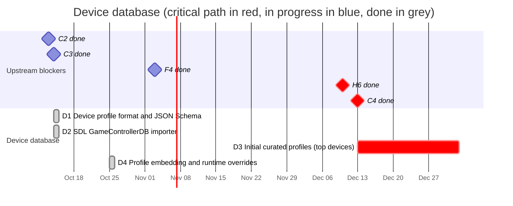

# 02 — Device database

Curated, versioned device profiles that tell the mapping engine how to turn a
specific device (in a specific mode, on a specific OS and transport) into the
canonical model.

## Schedule

## Tasks

| ID | Task | Days | Blocked by | Blocks | Start | End | Slack |
|----|------|-----:|------------|--------|-------|-----|------:|
| D1 | Device profile format and JSON Schema | 10 | C2 | C3, D2, D3, D4, P1, P4, H2 | 2026-10-14 | 2026-10-14 | done |
| D2 | SDL GameControllerDB importer | 7 | D1 | W5 | 2026-10-14 | 2026-10-14 | done |
| D3 | **Initial curated profiles (top devices)** | 20 | D1, C4, F4, H6 | C8 | 2026-12-13 | 2027-01-02 | 0 |
| D4 | Profile embedding and runtime overrides | 7 | D1, C3 | C10, W5, M1 | 2026-10-25 | 2026-10-25 | done |

### D1 — Device profile format and JSON Schema

- One file per device family in `data/profiles/`, human-reviewable in PRs.
- A profile has **match rules** (identity fields from C2, optionally OS,
  transport and descriptor fingerprint) and **mappings** (raw element ->
  canonical element plus calibration).
- Per-OS/per-transport/per-browser overrides inside the same profile, because
  the same pad differs between Windows, Linux and macOS, and browsers apply
  their own Gamepad API remapping.
- Schema version field; JSON Schema published for tooling and the web app.

Status (2026-10-14): done
(`RECORD/2026-10-14.d1-profile-format.completed.md`): `anygamepad-db`
profile types (match rules, mapping entries with `when` conditions, SDL-style
input strings), selection between matching profiles, TOML read/write, the
generated `data/profiles/schema.json` (also served at
`https://anygamepad.github.io/schema/profile.json`) and a first curated
profile for the Gamepad API standard layout. Calibration is a per-axis
deadzone for now.

### D2 — SDL GameControllerDB importer

Bootstrap coverage by converting SDL GameControllerDB entries into anygamepad
profiles (marked `source = "sdl-gamecontrollerdb"`, `verified = false`).
Keep attribution and license notice.

Status (2026-10-14): done
(`RECORD/2026-10-14.d2-sdl-gamecontrollerdb-importer.completed.md`):
`anygamepad_db::sdl` converts the vendored copy in `data/sdl-gamecontrollerdb/`
(2,279 entries, all of them) into profiles in memory; nothing is copied into
`data/profiles/`. Their indices are SDL's (`indices = "sdl"`), so they apply
once a provider reproduces SDL's order (C4, C13) and are embedded by D4.

### D3 — Initial curated profiles

Hand-verified profiles for the devices in the hardware lab (F4), at least:
Xbox 360, Xbox One/Series, DualShock 4, DualSense, Switch Pro Controller, and
multi-mode third-party pads (8BitDo, GuliKit) in each of their modes. Verified
first on Linux (the first backend available), then on Windows and macOS as C5
and C6 land.

Re-planned on 2026-10-31: also blocked by the first test campaign (H6). A
curated profile is `verified` when a test report (H1) of that model, mode,
transport and OS passes its control checks, and the profile names the
reports that verify it. The collection campaign (H9) runs alongside and
brings the rest of the owner's collection (DualShock 3, GameSir and more).

### D4 — Profile embedding and runtime overrides

Profiles are embedded at compile time (no network access needed by games) and
can be overridden by a user/game-provided file at runtime. The same embedded
database ships inside the web app's `.wasm` bundle, so a compact encoding may
be needed to keep the bundle small.

Status (2026-10-25): done (`RECORD/2026-10-25.d4-profile-embedding.completed.md`).
`anygamepad_db::wire` encodes profiles compactly with `postcard`. Build script
embeds curated profiles (`data/profiles/`) and SDL GameControllerDB (`data/sdl-gamecontrollerdb/`).
`Database::embedded()` provides immediate in-memory lookups, with `load_override_toml()`
and `add_override()` for runtime overrides. On WebAssembly targets, SDL entries
are omitted to preserve the 128 KiB bundle budget (current `.wasm` size: 105.9 KiB gzip).
`Mapper::from_database` resolves mappings against raw layouts directly.
