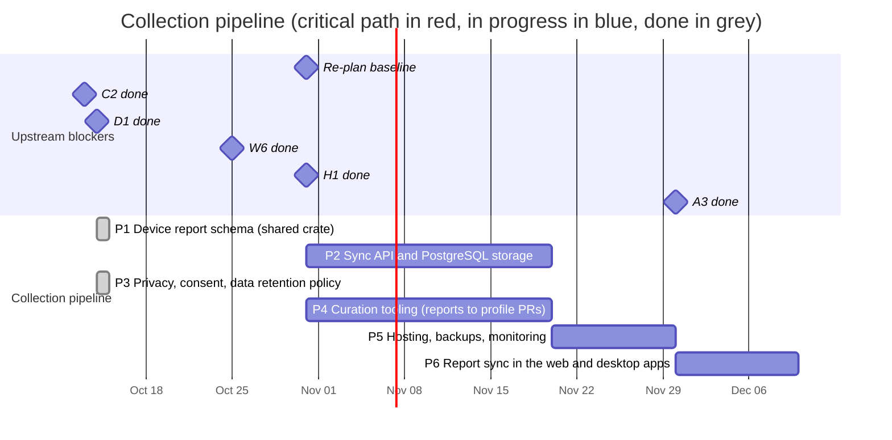

# 03 — Collection pipeline

How device reports are kept, shared and turned into curated profile
updates. Reports are local first
([ADR 0007](../../docs/adr/0007-local-first-device-reports.md), re-planned
in place on 2026-10-14): the desktop app writes files, the web app keeps
them in IndexedDB, people share the ones they choose as GitHub issues, and a
sync server comes after the web launch (M2).

## Schedule

## Tasks

| ID | Task | Days | Blocked by | Blocks | Start | End | Slack |
|----|------|-----:|------------|--------|-------|-----|------:|
| P1 | Device report schema (shared crate) | 7 | C2, D1 | P2, P3, P4, W6, A3, H1 | 2026-10-14 | 2026-10-14 | done |
| P2 | Sync API and PostgreSQL storage | 20 | P1 | P5, P6 | 2026-10-31 | 2026-11-20 | 43 |
| P3 | Privacy, consent, data retention policy | 10 | P1 | W6, A3 | 2026-10-14 | 2026-10-14 | done |
| P4 | Curation tooling (reports to profile PRs) | 20 | P1, D1, H1 | - | 2026-10-31 | 2026-11-20 | 53 |
| P5 | Hosting, backups, monitoring | 10 | P2 | M5 | 2026-11-20 | 2026-11-30 | 43 |
| P6 | Report sync in the web and desktop apps | 10 | P2, W6, A3 | M5 | 2026-11-30 | 2026-12-10 | 33 |

### P1 — Device report schema

Shared crate `anygamepad-report` (plus generated JSON Schema) describing a
report. The web app builds reports with this same crate running in WebAssembly
(TypeScript types come from the `anygamepad-wasm` bindings, C11), so web and
desktop reports are produced by identical code:

- Source (web or desktop), app/browser version, OS and version.
- Identity fields (C2): VID/PID, version, bus, names as reported by each API
  (e.g. the browser Gamepad `id` string, which differs between browsers).
- Per-provider view (desktop): how native, SDL3 and gilrs each see the device
  (C12).
- Raw data when available: HID report descriptor, sample input reports,
  button/axis counts, browser `mapping` value.
- User-confirmed mapping from the guided wizard (W4) and the mode the user says
  the controller is in.
- **Never** serial numbers, Bluetooth MAC addresses or any personal data:
  stripped on the client and validated again by every reader.

Status (2026-10-14): done
(`RECORD/2026-10-14.p1-device-report-schema.completed.md`). The format is
documented in [`data/reports/`](../../data/reports/README.md); its compact
JSON fits a GitHub issue (ADR 0007). The WASM bindings that build reports in
the browser come with W6, their first caller.

### P2 — Sync API and PostgreSQL storage

Re-planned on 2026-10-14 (ADR 0007): the server is a sync target after the
web launch, not a blocker of it. Rust `axum` service, PostgreSQL storage
([ADR 0006](../../docs/adr/0006-server-stack.md)), validation with the same
crate as the clients, storage of the re-serialized report, deduplication by a
hash of its compact JSON, rate limiting, and an anonymous submission token.

### P3 — Privacy, consent, data retention

Privacy policy, explicit consent screen text, retention periods, GDPR data
handling (no IP addresses stored beyond rate limiting), public data license for
the aggregated dataset.

Status (2026-10-14): done
(`RECORD/2026-10-14.p3-privacy-consent-retention.completed.md`). The policy
is a page of the web app, <https://anygamepad.github.io/privacy/>
(`apps/web/privacy/index.html`), linked under the tester; the consent texts
of W6, A3 and the issue form, the retention rules, the handling of shared
reports and the rules for the sync server are in
[`docs/privacy/`](../../docs/privacy/README.md). Owner decisions: reports
are dedicated to the public domain under CC0 1.0
([`data/reports/LICENSE-CC0`](../../data/reports/LICENSE-CC0)); the only
contact channel is this repository's issues; a curated report's issue is
closed and kept, and deleted on request.

### P4 — Curation tooling

Aggregate reports per fingerprint, show disagreements between reports, and
generate profile PRs for `data/profiles/` that a maintainer reviews. Reads
reports from GitHub issues labelled `device-report` and from files (ADR
0007), so it needs P1 only; the sync database becomes one more source after
P2.

Re-planned on 2026-10-31: also blocked by H1. Curation reads test reports
(`data/test-reports/`) as well, which carry ground truth: the model and
mode the person set, and which controls passed.

### P5 — Hosting, backups, monitoring

Deployment target for the sync API and PostgreSQL (the web frontend is
static and lives on GitHub Pages, see W7), automated backups, uptime and error
monitoring. CORS allows the `https://anygamepad.github.io` origin.

### P6 — Report sync in the web and desktop apps

Added on 2026-10-14 (ADR 0007). The web app (IndexedDB, W6) and the desktop
app (report files, A3) upload the reports the person chooses to the sync API,
remember which ones were uploaded, and keep working offline. Consent and
texts follow P3. Reaching milestone M5 (reports synchronized) closes the loop
that issues bridge until then.
