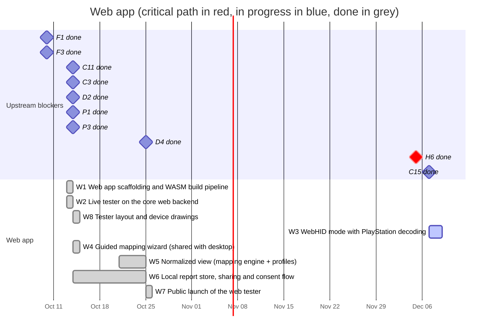

# 04 — Web app

A gamepad tester in the spirit of hardwaretester.com/gamepad that also collects
device reports. **Top priority of the project**: its launch (M2) gates the
desktop app.

**The web app runs the anygamepad Rust library compiled to WebAssembly.** All
device access (Gamepad API, WebHID), normalization, profile matching and report
building happen inside the library; the web frontend only renders state and
handles user interaction. This makes the web app a real consumer of the
library: what users see in the browser is exactly what a Rust game would get.

**Hosting:** the web app is a static site published on GitHub Pages at
<https://anygamepad.github.io> (the user/organization site served by this
repository). Reports stay in the browser until the person shares them
([ADR 0007](../../docs/adr/0007-local-first-device-reports.md)); only the
later sync API (P2, P5) needs a server.

**Test mode:** the tester's test mode (H4) is planned with the desktop
app's in [06-hardware-testing.md](06-hardware-testing.md).

## Schedule

## Tasks

| ID | Task | Days | Blocked by | Blocks | Start | End | Slack |
|----|------|-----:|------------|--------|-------|-----|------:|
| W1 | Web app scaffolding and WASM build pipeline | 7 | F1, F3 | W2 | 2026-10-13 | 2026-10-14 | done |
| W2 | Live tester on the core web backend | 15 | W1, C11 | W8, W3, W4, W5 | 2026-10-13 | 2026-10-14 | done |
| W8 | Tester layout and device drawings | 7 | W2 | W3 | 2026-10-14 | 2026-10-14 | done |
| W3 | WebHID mode with PlayStation decoding | 2 (of 15) | W2, C15, W8, H6 | - | 2026-12-07 | 2026-12-09 | 49 |
| W4 | Guided mapping wizard (shared with desktop) | 15 | W2 | W6, A3, H3 | 2026-10-14 | 2026-10-14 | done |
| W5 | Normalized view (mapping engine + profiles) | 10 | W2, C3, D2, D4 | W7 | 2026-10-21 | 2026-10-25 | done |
| W6 | Local report store, sharing and consent flow | 10 | W4, P1, P3 | P6, W7 | 2026-10-14 | 2026-10-25 | done |
| W7 | Public launch of the web tester | 5 | W5, W6 | M2 | 2026-10-25 | 2026-10-25 | done |

### W1 — Web app scaffolding and WASM build pipeline

Frontend project (Vite + TypeScript + jq79, see
[ADR 0005](../../docs/adr/0005-web-stack.md)), build pipeline that compiles the
library's JS bindings crate (`anygamepad-wasm`) with `wasm-bindgen`, preview
deployments from CI, bundle size budget for the `.wasm` file. Deployment to
GitHub Pages through a GitHub Actions workflow that publishes only the built
`apps/web` output (not the repository contents).

Status (2026-10-13): done
(`RECORD/2026-10-13.w1-web-scaffolding.completed.md`). Previews are build
artifacts, not hosted sites (GitHub Pages hosts one site per repository).

### W2 — Live tester on the core web backend

Live view of buttons and axes for every connected pad, driven by the library's
web backend (C11): browser `id` string, browser `mapping` value, raw values,
polling rate, vibration test. Must work on Chromium, Firefox and Safari.

Status (2026-10-13): done
(`RECORD/2026-10-13.w2-live-tester.completed.md`). Tested with fake gamepads
in Chromium, Firefox and WebKit (CI); real gamepads and Safari itself are
not yet verified.

Status (2026-10-14): first real-device test. The owner's DualSense does not
show in Chrome on macOS (macOS switches it to its extended report, see the
[README](README.md#changes-from-2026-10-10)); the tester now explains this to
Chromium users on macOS while no gamepad shows
(`RECORD/2026-10-14.chromium-macos-dualsense-hint.completed.md`).

### W3 — WebHID mode with PlayStation decoding

Chromium-only opt-in mode (requires a user gesture and the browser's device
chooser) on the library's WebHID access (C11):

- **Raw view** for any HID game controller: VID/PID, report descriptors
  (collections) and live raw input reports — the same data the desktop
  collector gets, without installing anything.
- **Decoded view** for PlayStation pads, through C15: the same live card as
  the Gamepad API pads (drawing, canonical names, update rate), plus what the
  Gamepad API lacks (touchpad points, raw IMU, battery). This is how a
  DualSense shows in Chromium on macOS.
- **One card per pad**: a pad open through WebHID hides its Gamepad API twin
  (same VID/PID).
- **Report modes**: reading feature reports switches a Bluetooth pad to its
  full report for every application until it is power-cycled, so W3 reads
  them only after telling the user (on macOS the system has already switched
  it). It reads firmware information (`0x20`) and calibration only.
- **Privacy**: no factory test commands, no pairing report (it holds the
  Bluetooth MAC), no serial number (AGENTS.md); on the DualShock 3, never
  feature reports `0xf2` and `0xf5` (the pad's and the host's MAC).
- The macOS hint of W2 points to this mode once it exists.
- The panels go into W8's layout: touchpad, motion and battery next to the
  drawing, the raw view folded like the Gamepad API raw values.

- **Recording**: the raw view records two seconds of reports to a JSON file
  (identity, report structure, reports; nothing identifying), the real
  reports C15's tests need.

**Done when:** the owner's DualSense shows, decoded and live, in Chrome on
macOS over USB and Bluetooth; the raw view works for a non-PlayStation pad;
the smoke test covers both views with fake `HIDDevice`s.

Status (2026-10-14): implemented
(`RECORD/2026-10-14.w3-webhid-playstation.WIP.md`), with a smoke test on a
fake Bluetooth DualSense; waiting on the owner's check with a real pad.

Status (2026-10-31): left (2 days): the owner's check, now through the
web test mode (H4) in the first test campaign (H6), over USB and
Bluetooth on macOS, Windows and Linux.

### W8 — Tester layout and device drawings

Added on 2026-10-14 at the owner's request, after `ds.daidr.me` (MIT; ideas,
not code or artwork):

- Two columns on wide screens: the connected pads on the left, the selected
  pad on the right, drawn large with its facts, update rate and vibration
  test; one column on phones.
- One drawing per family, chosen by the owner: DualShock 3, DualShock 4,
  DualSense (and Edge), Switch Pro Controller, Xbox; every other pad gets a
  generic drawing after the Flydigi Vader 5 Pro, with its C and Z buttons
  and four back buttons. Face buttons show what is printed on them (letters
  or PlayStation symbols). No logos. The DualSense and DualShock 4 drawings
  are the owner's illustrations (`apps/web/src/art/`, controls marked with
  data attributes); the others are shapes, until illustrations replace
  them.
- The library recognizes the family (`Family`, from VID/PID, XInput or the
  name Safari's GameController gives) and what is printed on the face
  buttons (`FaceLayout`); the page picks the drawing. These rules are a
  stopgap: device profiles (D4), built from collected reports, replace them.
- An option to show the values on the drawing (trigger travel, stick
  positions).
- The raw buttons and axes stay, folded under the drawing.

Status (2026-10-14): done
(`RECORD/2026-10-14.w8-tester-layout-and-drawings.completed.md`). The Xbox
and generic drawings are now the owner's Xbox illustration, with C and Z and
the back buttons on generic pads
(`RECORD/2026-10-14.w8-xbox-illustration.completed.md`), and the DualShock 3
drawing is the owner's illustration too, with one stick colour across every
drawing and a placeholder while no pad is selected
(`RECORD/2026-10-14.w8-dualshock3-and-placeholder.completed.md`).

**Done when:** the smoke test covers the layout, the selection and the
drawings in Chromium, Firefox and WebKit.

Status (2026-10-14): implemented
(`RECORD/2026-10-14.w8-tester-layout-and-drawings.completed.md`); the smoke
test passes in Chromium locally, Firefox and WebKit run in CI.

### W4 — Guided mapping wizard

"Press the bottom face button", "Move the left stick up", ... records what the
user confirms and produces a user-verified mapping in canonical model terms
(C1). The wizard's state machine lives in the library so the desktop collection
mode (A3) reuses the same logic; the web app only provides the UI.

- Owner request (2026-10-14): for a connected pad, a view that asks for the
  buttons of the usual layout one by one, and a button combination on the
  pad itself to say the pad does not have the one asked for. The
  combination is the first two buttons the wizard identified, pressed
  together (the bottom and right face buttons); the view also has buttons
  for it, for going back and for starting over.
- Steps: face buttons, d-pad, shoulders, triggers, menu buttons, the system
  button, each stick (right, up) and its click. Answers can be buttons, hat
  directions, axes or half axes; an element that answered an earlier step is
  refused and named.
- The result is a `Mapping` in the profile format (D1), plus the controls
  the person said the pad lacks, as the device report stores them (P1).
- Gamepad API pads use their raw buttons and axes; PlayStation pads decoded
  over WebHID (W3) use their canonical controls, so the wizard checks the
  decoding. Raw WebHID devices wait for a HID report parser.

**Done when:** the library's tests cover the detection rules and give the
curated standard profile from a standard pad; the smoke test runs the whole
wizard on a pad without the standard mapping (its d-pad on axes,
combination and button skips, back, the mapping driving the drawing) and on
a decoded WebHID pad.

Status (2026-10-14): done
(`RECORD/2026-10-14.w4-guided-mapping-wizard.completed.md`), with fake pads;
not yet tried on a real one.

### W5 — Normalized view

Show the canonical output produced by the mapping engine (C3) and the embedded
profiles (D4, bootstrapped with the SDL GameControllerDB import D2) next to the
raw values, and highlight where it disagrees with what the user confirmed in
the wizard.

Status (2026-10-25): done
(`RECORD/2026-10-25.w5-normalized-view.completed.md`).

### W6 — Local report store, sharing and consent flow

Re-planned on 2026-10-14
([ADR 0007](../../docs/adr/0007-local-first-device-reports.md)); it was
"Report submission and consent flow", blocked by the ingestion API (P2).

- The library builds the device report (P1) inside WASM, so web and desktop
  reports come from the same code: `anygamepad-wasm` gains the calls that
  build, scrub and validate a report for a connected pad, and the TypeScript
  types of the report.
- "Save a report" stores it in IndexedDB (database `anygamepad`, store
  `reports`), never automatically. A list of saved reports with preview,
  download (the same JSON) and delete; persistent storage requested, and a
  note that private windows and Safari can drop it.
- "Share" previews exactly what will be shared, with consent text (P3),
  copies the compact JSON and opens the `device-report` GitHub issue form
  (`.github/ISSUE_TEMPLATE/device-report.yml`, added here), whose required
  checkbox confirms the review.
- The texts of saving, sharing and the issue form are P3's, verbatim
  ([`docs/privacy/`](../../docs/privacy/README.md#consent-texts)); the
  policy page links from the share view and the form.

**Done when:** a report of a pad can be saved, listed, downloaded, deleted
and shared through the issue form in Chromium, Firefox and WebKit (smoke
test with fake pads), and what the form receives reads back with
`Report::from_json`.

Status (2026-10-25): done
([`RECORD/2026-10-25.w6-local-report-store.completed.md`](../../RECORD/2026-10-25.w6-local-report-store.completed.md)).

### W7 — Public launch

Production deployment of the web app on GitHub Pages
(<https://anygamepad.github.io>), with local reports and sharing through
issues (W6). Reaching this milestone (M2) starts the data collection loop;
sync with the server (P6) follows.

Status (2026-10-25): done
([`RECORD/2026-10-25.w7-public-launch.completed.md`](../../RECORD/2026-10-25.w7-public-launch.completed.md)),
achieving Milestone M2.
