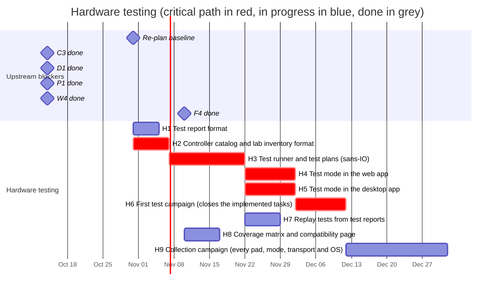

# 06 — Hardware testing

Added on 2026-10-31 at the owner's request: a **test mode** in every app,
and a test lab around it, so that testing real controllers is robust,
comfortable and keeps working as apps, providers and controllers are added.
Decision record: [ADR 0008](../../docs/adr/0008-test-mode-and-test-reports.md).

The owner collects controllers (several DualSense, Xbox Series, DualShock 4,
DualShock 3, 8BitDo, GuliKit, GameSir and other brands and models) and can
test them on Windows, Linux and macOS. Until now each task was checked by
hand with its own instructions (an example program, a recording button, a
checklist in a chat), and the results lived in chat messages. In test mode
the person picks the controller, its mode and its transport; the app guides
them through the checks, verifies on its own what it can, asks about what
only a person can see or feel (vibration, lights), and writes a **test
report** file (a download on the web).

Every app runs the same test runner, the same test plans and writes the
same report format, all in the library, so a new controller, a new check or
a new app (or provider) is added once:

| To add | Change |
|--------|--------|
| A controller model | A catalog file in `data/controllers/` (and a unit in the inventory) |
| A check | An entry in a test plan in `data/test-plans/` |
| A kind of check | Its implementation in the runner (H3), then every app has it |
| An app or a provider (C5, C6, C13, C14, motorust) | Feeding the runner raw states and events, as the web and desktop apps do |

Test reports then serve four purposes: they close tasks (the evidence that
a feature works on a real pad), become regression tests (H7), fill the
compatibility matrix (H8), and are the verified data the curated profiles
(D3) and the mode and clone detection (C8) are built on.

## Concepts

- **Catalog model** (`data/controllers/`): a controller model as sold
  (`8BitDo Ultimate 2C Wireless`), with its controls, sensors, outputs and
  **modes** (as printed on the switch or in the manual, how to switch to
  each, the transports it offers and the identity expected in each). Generic
  types cover unlisted pads: `generic/xinput`, `generic/playstation`,
  `generic/switch-pro`, `generic/hid`.
- **Unit**: one physical controller of the lab, with the label its owner
  gives it (`DS5-02`), its catalog model and notes (edition, colour,
  firmware as a vendor app shows it). The **inventory**
  (`data/lab/inventory.toml`, F4) lists the units and the test machines.
- **Configuration**: unit × mode × transport (USB cable, Bluetooth, 2.4 GHz
  dongle).
- **Environment**: OS and release × app × API or provider (web: browser
  engine and version, Gamepad API or WebHID; desktop: evdev, hidraw, later
  XInput, Windows HID, GameController, IOKit, SDL3, gilrs).
- **Test plan** (`data/test-plans/`): suites of steps; each step is a kind of
  check with its parameters and when it applies (the model has motion, the
  API reads it, ...).
- **Test session**: one configuration in one environment with one plan. It
  produces one **test report**.

## A test session

1. Open the test mode: a tab in the web tester, a page in the desktop app.
2. Pick the unit from the inventory (search; the least tested first), or
   "Not in the inventory": a catalog model or a generic type.
3. Pick the mode and the transport. The app shows how to put the pad in
   that mode and connect it, from the catalog.
4. Connect it. The app picks the device whose identity matches the one the
   catalog expects for that mode, or lets the person pick; a mismatch is a
   finding, recorded in the report (a clone, a firmware change, or a catalog
   to correct).
5. Pick the plan: **Quick** (about a minute: detection and every control) or
   **Full** (about five: also sticks and triggers, rate, motion, touchpad,
   battery, outputs, hotplug). Suites can be left out.
6. One step at a time, with the drawing highlighting the control ("Press
   Cross"). Automatic checks pass or fail by themselves. "Not on this pad"
   and "Skip" work from the pad (the wizard's chord) and from the screen;
   yes/no questions are answered on the pad too, so the hands stay on it.
   Back and pause.
7. Summary: passed, failed, skipped and findings, with a free note. Save:
   a file on the desktop, IndexedDB plus a download on the web.
8. Next: the app suggests the next configuration of the same unit that is
   untested in this environment (H8's coverage), so going through every mode
   and transport of a pad needs no bookkeeping.

A session is saved as it runs, so a closed tab or a crash loses at most
the current step.

## Checks (first set)

| Suite | Check | How | What it proves |
|-------|-------|-----|----------------|
| Detection | The device appears; its identity (VID/PID, name, family) matches the catalog for the mode; transport; profile or decoder chosen | automatic | Identification (C2, C8, D3) |
| Controls | Each control of the model in turn: the canonical state shows exactly the expected control. A failure records which raw element answered, so a failed run also yields the right mapping | automatic | Mapping, profiles, decoders (C3, C15, C7, D3) |
| Sticks | Rest (noise, drift, centre), a full circle (range per direction, circularity), clicks | automatic, with tolerances | Calibration, ranges |
| Triggers | Rest and a full pull (0 to 1); digital-only triggers flagged | automatic | Ranges |
| Rate | Input reports per second and jitter while moving | measured | Polling, transports |
| Motion | At rest (gyroscope near 0, acceleration near g); guided turns (axis and sign of each gyroscope axis) | automatic | IMU calibration and axes (C7) |
| Touchpad | Four corners, two fingers, click | automatic | Touch decoding |
| Battery | Level reported, charging state with and without the cable | automatic and asked | Battery decoding |
| Outputs | Each motor, light bar colours, player LEDs, mute LED (adaptive triggers when C7 has them) | the app sends, the person answers | Output reports (C7), drivers |
| Hotplug | Unplug or turn off, then reconnect: removed, then back with the same identity | automatic, prompted | Providers' hotplug |
| Virtual output (desktop) | A virtual pad of each target made from this unit and read back through the app's own provider (loopback); vibration sent to the virtual pad reaches the physical one | automatic and asked | A5 (A7, A8 later) |

Each result has a status (`pass`, `fail`, `skipped`, `not_applicable`,
`error`), what was expected, what was observed, measurements and a note.

## Schedule

## Tasks

| ID | Task | Days | Blocked by | Blocks | Start | End | Slack |
|----|------|-----:|------------|--------|-------|-----|------:|
| H1 | Test report format | 5 | P1 | P4, H3, H8 | 2026-10-31 | 2026-11-05 | 2 |
| H2 | **Controller catalog and lab inventory format** | 7 | D1 | F4, H3 | 2026-10-31 | 2026-11-07 | 0 |
| H3 | **Test runner and test plans (sans-IO)** | 15 | H1, H2, C3, W4 | H4, H5, H7 | 2026-11-07 | 2026-11-22 | 0 |
| H4 | **Test mode in the web app** | 10 | H3 | H6 | 2026-11-22 | 2026-12-02 | 0 |
| H5 | **Test mode in the desktop app** | 10 | H3 | H6 | 2026-11-22 | 2026-12-02 | 0 |
| H6 | **First test campaign (closes the implemented tasks)** | 10 | H4, H5, F4 | C4, C15, D3, W3, A1, H9, M6 | 2026-12-02 | 2026-12-12 | 0 |
| H7 | Replay tests from test reports | 7 | H3 | - | 2026-11-22 | 2026-11-29 | 66 |
| H8 | Coverage matrix and compatibility page | 7 | H1, F4 | - | 2026-11-10 | 2026-11-17 | 78 |
| H9 | Collection campaign (every pad, mode, transport and OS) | 20 | H6 | C8 | 2026-12-12 | 2027-01-01 | 3 |

### H1 — Test report format

One JSON document, format `anygamepad-test-report`, schema version 1,
next to the device report in `anygamepad-report` (P1) and built by the same
Rust code in every app (WebAssembly on the web):

- **Environment**: app, app and library versions, OS and release, browser,
  API or provider.
- **Configuration**: unit label, catalog model, mode, transport, the
  person's notes.
- **Device under test**: the device report (P1) of what the app saw:
  identity and fingerprint, raw layout, HID data. Test reports reuse its
  scrubbing and validation.
- **Plan**: its ID and version, and the steps run.
- **Results**: one per step (status, expected, observed, measurements,
  note), and a summary.
- **Evidence**: the input of each step's window (raw states, and the input
  reports when the API reads HID), with times relative to the step's start,
  capped per step, so every step's recording comes with what the person was
  asked to do.

No serial numbers, Bluetooth MAC addresses, times of day or other personal
data (AGENTS.md); unit labels are names for pads, and the format says so.
Reports are files, not issue bodies: their size budget (a few MB, the
evidence caps set from measurements of a DualSense over USB) is H1's to
fix. File name:
`<unit or model>-<mode>-<transport>-<os>-<app>-<api>-<YYYY-MM-DD>-<n>.json`.
A JSON Schema is generated, as for device reports.

**Done when:** the types, the JSON Schema and an example are in the
repository, a report round-trips through JSON, and validation rejects
identifiers in every free-text field.

### H2 — Controller catalog and lab inventory format

- **Catalog**, `data/controllers/<vendor>/<model>.toml`: ID, vendor, model,
  family (for the drawing) and face labels; controls by canonical name
  (back paddles and extra buttons included); sticks; triggers (analog or
  digital); motion; touchpad; battery; outputs; modes, each with its name
  as printed, how to switch to it, its transports and the identity
  expected on each (or unknown, until a test report shows it). The generic
  types of [Concepts](#concepts). A catalog model is what a person can buy;
  a device profile (D1) is how to map an identity: models point to the
  profiles that match their modes.
- **Inventory**, `data/lab/inventory.toml`: units (label, model, notes)
  and machines (label, OS and release, browsers).
- Rust types in `anygamepad-db`, JSON Schemas, validation in CI (every
  model referenced exists, every mode has a transport), and both embedded
  in the apps at build time; the apps can also import an inventory file,
  for a pad not committed yet or a tester other than the owner.
- First entries: the generic types and the families the library already
  knows (DualSense, DualSense Edge, DualShock 4, DualShock 3, Switch Pro,
  Xbox 360, Xbox One/Series), so H3 has data to run on.

**Done when:** the formats are documented, the schemas generated, CI
validates `data/controllers/` and `data/lab/`, and the first entries are
in.

### H3 — Test runner and test plans

A sans-IO state machine in the library, `anygamepad::testing`, like the
guided wizard (W4) whose detection rules it reuses: fed with the device's
raw state, canonical state and provider events once a frame, it shows the
current step's prompt, decides automatic checks, takes the person's answers,
asks the app to send outputs, records the evidence and builds the test
report (H1).

- Test plans as data in `data/test-plans/` (Quick and Full first),
  embedded in the apps; a step names a kind of check, its parameters and
  when it applies (model capabilities from the catalog, what the API
  reads).
- The kinds of check of [Checks](#checks-first-set), with their tolerances
  in the plans.
- Pure and deterministic, so it is tested with recorded and built input
  like the wizard, and runs unchanged in WebAssembly.
- WASM bindings for the web app (`anygamepad-wasm`).

**Done when:** tests run the Quick and Full plans on built input for a
standard pad, a decoded DualSense, a pad that lacks controls and a pad
that answers with the wrong control, and the reports they produce
validate.

### H4 — Test mode in the web app

A "Test" tab in the web tester: the session of
[A test session](#a-test-session) on the Gamepad API and on WebHID (decoded
PlayStation pads, and raw HID pads as H3 can read them), with the
drawings of W8 highlighting each step. Sessions and reports are kept in
IndexedDB (store `test-reports`, ADR 0007's rules) and downloaded as
files; nothing is shared by itself. Works in Chromium, Firefox and Safari
(WebHID in Chromium only), on Windows, Linux and macOS.

**Done when:** the smoke test runs a Quick session with a fake Gamepad API
pad and a Full session with a fake WebHID DualSense (outputs answered) in
Chromium, Firefox and WebKit, and downloads a report that validates.

### H5 — Test mode in the desktop app

A "Test" page in the desktop app (A1's shell, A2's device worker): the
same session on Linux with the evdev and hidraw providers (C4), and on
Windows and macOS once their backends exist (C5, C6). Reports are written
to `test-reports/` in the app's data directory (next to A3's `reports/`).
Adds the **virtual output** suite (A5): for each target, the app creates
the virtual pad from the unit under test, reads it back through its own
provider and compares, then asks whether the vibration sent to the
virtual pad reached the physical one. Until then, `ANYGAMEPAD_DEMO=1`
runs a session on the demo pad (Windows, macOS, CI).

**Done when:** a test runs a Quick session on the demo pad and checks the
report file; on Linux, the virtual output suite runs where `/dev/uinput`
and `/dev/uhid` exist and is skipped with a reason where they do not.

### H6 — First test campaign

The owner runs the test modes on the pads and environments that close the
tasks implemented but never tried on hardware; the fixes go into those
tasks (their remaining days), and the reports chosen are committed to
`data/test-reports/`.

| Closes | Environment | Pads |
|--------|-------------|------|
| C15, W3, C7 (web) | Web test mode, WebHID, Chrome on macOS, then Windows and Linux | DualSense and DualShock 4 over USB and Bluetooth (DualSense Edge if at hand) |
| C4 | Desktop test mode on Linux, evdev | DualSense, DualShock 4, DualShock 3, Xbox Series, Switch Pro or a pad in Switch mode |
| C4, C7 (hidraw) | Desktop test mode on Linux, hidraw (pad on `hid-generic`) | DualSense, DualShock 4, Switch Pro |
| A1, A2, A3, A11 | Desktop app on Linux (X11 and Wayland) with real pads; Windows and macOS with the demo pad | the same |
| A5 | Virtual output suite on Linux, every target | DualSense and Xbox Series as sources |

**Done when:** every row has a test report, the tasks it closes are
marked done (or re-planned with what the reports showed), and milestone
M6 is reached.

### H7 — Replay tests

Every test report in `data/test-reports/` becomes a regression test:
`cargo test` replays its evidence through what the current code would use
(decoder, provider layout, mapping) and checks each step's ground truth
(the control pressed during the step, motion axes and signs, ranges). A
change that breaks a pad that once passed fails CI. C15's fixtures come
from here; W3's "Record 2 seconds" stays for quick recordings. Generic HID
pads replay through a HID report parser (the `anygamepad-hid` crate on
an unmerged branch is a candidate).

**Done when:** CI replays every committed report, and a test shows that a
deliberately broken mapping fails.

### H8 — Coverage matrix and compatibility page

A library function computes, from the catalog, the inventory and the test
reports, the latest result of every configuration in every environment:
pass, fail, partial or untested. It drives the test modes' "Next" (H4,
H5), a generated matrix for maintainers, and a public **compatibility
page** in the web app: which controllers work in which mode, on which OS,
browser and API, with what is known not to work.

**Done when:** the page is built from `data/` on every deploy and the
test modes suggest the next untested configuration.

### H9 — Collection campaign

The whole collection, every mode and transport: in the web test mode on
the three OSes (every browser each OS has), in the desktop test mode on
Linux, and on Windows and macOS as C5 and C6 land (not blocking). D3's
list goes first (Xbox 360, Xbox One/Series, DualShock 4, DualSense, Switch
Pro, 8BitDo and GuliKit pads in each of their modes), then the rest
(DualShock 3, GameSir and the other brands). Catalog entries are corrected
from what the reports show. It feeds D3 (profiles verified by test
reports) and C8 (identities per mode, with ground truth). It goes on after
this roadmap: every new controller in the collection gets a session.

**Done when:** D3's list has a passing Full session per mode and
transport on Linux and in Chromium on each OS, and the rest of the
inventory a Quick session in at least one environment.
