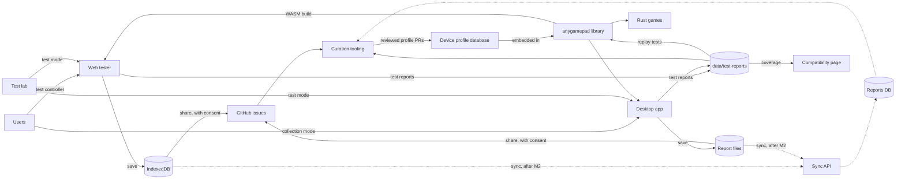
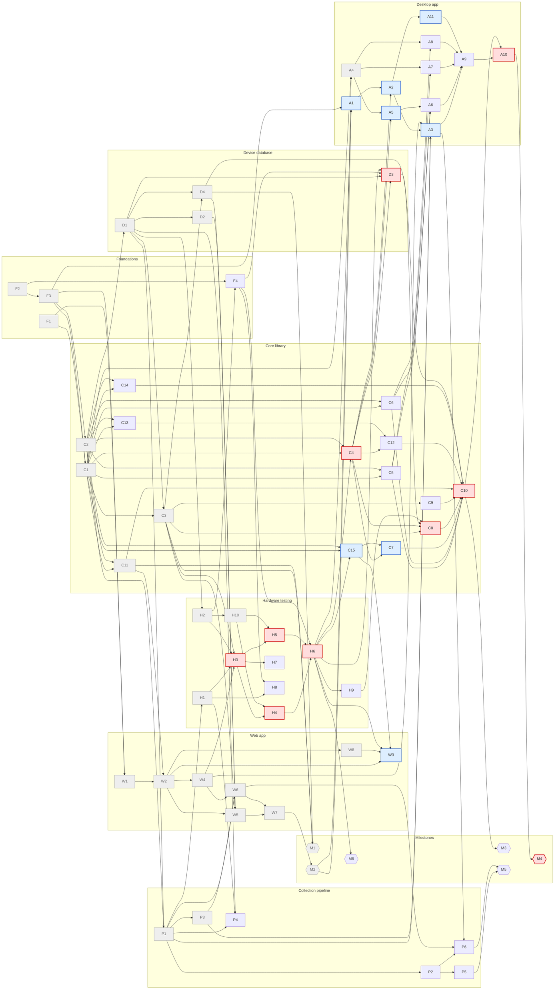

# anygamepad roadmap — 2026-10-31

Status: **active**. Supersedes [ROADMAP/2026-10-14/](../2026-10-14/README.md).

## Changes from 2026-10-14

- **New workstream: hardware testing**
  ([06-hardware-testing.md](06-hardware-testing.md),
  [ADR 0008](../../docs/adr/0008-test-mode-and-test-reports.md)). Owner
  request (2026-10-31): every app gets a **test mode** that opens on a
  list of controllers (picking one shows the ways to connect it), shows a
  pad connected without picking as detected (Confirm, or Choose another
  when it does not match), and writes an **anonymous test report** file
  (a download on the web).
  The owner collects controllers (several DualSense, Xbox Series,
  DualShock 4, DualShock 3, 8BitDo, GuliKit, GameSir and other brands) and
  tests on Windows, Linux and macOS. The runner, the test plans, the
  controller catalog and the report format live in the library, so new
  controllers, checks and apps are added once. Tasks H1-H10 and milestone
  M6 (test lab running).
- **Re-plan (2026-10-31, in place):** automatic detection (new H10, after
  H2, before H4 and H5, 10 days of slack) and anonymous test reports (H1,
  ADR 0008), at the owner's request the same day. No milestone moves.
- **Owner decision (2026-10-31):** go ahead with the test lab first; H1
  and H2 are next.
- **Status update (2026-10-31, in place):** H2, the controller catalog and
  the lab inventory format, is done (grey). Dates recomputed: M4 on
  2027-02-01, M3 on 2027-01-27, M5 on 2026-12-30, M6 on 2026-12-10; H1 is
  now on the critical path (t0 -> H1 -> H3 -> ...).
- **Status update (2026-10-31, in place):** H1, the test report format,
  is done (grey). Dates recomputed: M4 on 2027-01-27, M3 on 2027-01-22, M5 on
  2026-12-25, M6 on 2026-12-05; the critical path now starts at H3.
- **Status update (2026-10-31, in place):** H10, automatic detection, is
  done (grey). It had slack, so no date moves.
- **F4** becomes the lab inventory in H2's format: blocked by H2, 3 days
  instead of 5.
- **Tasks with merged code that were never tried on a real pad are in
  progress (blue):** C15 and W3 (since 2026-10-14), C4, C7, A1, A2, A3, A5
  and A11 (since 2026-10-30). Each bar is what is left: the fixes the first
  test campaign (H6) finds, plus the work their RECORDs list (C7: adaptive
  triggers, the DualSense Bluetooth light bar set-up, the Switch Pro
  Controller over WebHID; A3: the wizard in the desktop app; A11: saving
  its position, the macOS window level).
- **New blockers:** D3 waits for H6 (profiles verified by test reports),
  C8 for H9 (identities per mode, with ground truth), P4 for H1 (curation
  reads test reports too).
- **Corrections:** D4, and so M1, are dated 2026-10-25, as their RECORDs
  say (the 2026-10-14 version showed 2026-10-21); the bars of W5, W6 and
  W7 use their RECORD dates.
- **Re-baselined on 2026-10-31.** M4 moves to 2027-02-03 (2027-01-09 in the
  2026-10-14 version, whose dates were not recomputed after 2026-10-25), M3
  to 2027-01-29, M5 to 2027-01-01; M6 lands on 2026-12-12. The critical
  path now runs through the test lab and the library:
  H2 -> H3 -> H4/H5 -> H6 -> C4 -> D3 -> C8 -> C10 -> A10 -> M4.
- The owner directions of 2026-10-14 still apply: `germadev/motorust` as
  the library's first consumer (not re-planned, not urgent) and local-first
  reports ([ADR 0007](../../docs/adr/0007-local-first-device-reports.md)).

## Vision

Gamepads lie about themselves. The same physical controller can expose a
different identity and a different input layout depending on:

- **Its mode**: many controllers switch between XInput, DirectInput, Nintendo
  Switch Pro Controller, DualShock 4/DualSense emulation, vendor modes
  (GuliKit, 8BitDo, ...), each with a different VID/PID and HID report layout.
- **The host OS**: Windows (XInput/HID/GameInput), Linux (evdev nodes created by
  `xpad`, `hid-playstation`, `hid-nintendo`, generic HID), and macOS (IOKit HID,
  GameController framework) each expose the device differently.
- **The transport**: USB, Bluetooth Classic and BLE often produce different
  report formats for the same device.
- **The browser**: the Gamepad API applies its own per-browser remapping, so
  Chromium, Firefox and Safari can disagree about the same pad on the same OS.

anygamepad normalizes all of this into **one canonical gamepad model**, and builds
a data loop to keep improving detection over time.

## Deliverables

| # | Deliverable | Detail |
|---|-------------|--------|
| 1 | **Rust library** (`anygamepad` crate) that Rust games embed to get normalized gamepad input, isolating them from device/mode/OS quirks. | [01-core-library.md](01-core-library.md), [02-device-database.md](02-device-database.md) |
| 2 | **Desktop app** (Windows, Linux, macOS) that detects controllers and exposes a **virtual controller** of a selectable type (Xbox 360, DualShock 4, DualSense, Switch Pro Controller, ...), similar to DS4Windows but multi-target and multi-OS. Performance-first native UI with an **always-on-top widget**. | [05-desktop-app.md](05-desktop-app.md) |
| 3 | **Web app** similar to hardwaretester.com/gamepad, built on the **anygamepad library compiled to WebAssembly**, that **collects reports of detected controllers** (kept locally and shared as GitHub issues first, synchronized with a database later; [ADR 0007](../../docs/adr/0007-local-first-device-reports.md)). Published on GitHub Pages at <https://anygamepad.github.io>. | [04-web-app.md](04-web-app.md), [03-collection-pipeline.md](03-collection-pipeline.md) |
| 4 | **Collection mode** in the desktop app, which gathers richer reports than the browser can (raw HID descriptors, OS driver info). | [05-desktop-app.md](05-desktop-app.md), [03-collection-pipeline.md](03-collection-pipeline.md) |

Every app also has a **test mode** that writes test reports: how the
project checks itself on real controllers, and the verified data behind
its profiles ([06-hardware-testing.md](06-hardware-testing.md)).
Cross-cutting groundwork lives in [00-foundations.md](00-foundations.md).

## Priorities

1. **Test lab** (owner request, 2026-10-31). Nine tasks have their code
   merged but were never tried on a real pad; the test modes (H4, H5) and
   the first test campaign (H6) close them, and every later task is checked
   the same way. H3 -> H4/H5 -> H6 is the start of the critical path.
2. **Library 0.1.0** (M3): the Windows and macOS backends (C5, C6), SDL3
   and gilrs (C13, C14), arbitration (C12), and the profiles and mode
   detection built on test reports (D3, C8).
3. **Desktop app** (M4): its own tasks have slack; its release waits for
   the library (C10) and the Windows and macOS backends.
4. The **web app** is live (M2): it gains the test mode (H4) and the
   compatibility page (H8); sync (P2, P5, P6) comes after.

## Input provider strategy

To support as many gamepads as possible, the library does not pick a single
input stack: it aggregates several **providers** and arbitrates between them
per physical device (C12).

| Provider | Platforms | Why |
|----------|-----------|-----|
| Native, own (C4-C7, C15) | Linux, Windows, macOS | Full control: modes, clones, own profiles, protocol drivers. |
| Web, own (C11) | Browser (WASM) | Gamepad API + WebHID; SDL3 does not target `wasm32-unknown-unknown`. |
| SDL3 (C13) | Linux, Windows, macOS | Widest existing coverage (SDL HIDAPI drivers + GameControllerDB). |
| gilrs (C14) | Linux, Windows, macOS | Pure-Rust fallback for games that cannot link C libraries. |

Each provider is a Cargo feature. Only one provider owns a given physical
device at a time (no duplicates, no competing handshakes); profiles can state
which provider handles a device best. In collection mode, every provider's view
of the device is recorded, so disagreements between them become data.

## The data loop

Every iteration of the project should feed collected reports back into the
curated profile database, so detection gets better with each release.
Reports leave a device only when its owner shares them (ADR 0007); dashed
arrows come with the sync server (P2, P5, P6). Test reports are the
verified part of the loop: they say what the controller is and which
controls passed (ADR 0008).

## Planning assumptions

- The 2026-10-14 version was re-baselined on 2026-10-14. This version is
  re-baselined on **2026-10-31**: done tasks show their actual start and
  end (`Slack` = `done`), and every other task starts at the baseline at
  the earliest.
- Tasks **in progress** (blue) have their code merged and wait for real
  controllers: their bar starts when their blockers allow, and `Days` is
  what is left, followed by the original estimate (`3 (of 20)`). For the
  other tasks `Days` is the estimate, also for done tasks. Durations are
  **calendar days** of focused work per task.
- Workstreams are assumed to progress **in parallel**. With a single
  contributor the dates stretch (and done tasks so far took far less than
  their estimates), but the dependency graph (what blocks what) stays
  valid. Use the graph, not the dates, to decide what to pick up next.
- The critical path ends at milestone M4 (desktop 0.1.0). Projected end:
  **2027-01-27** (2027-01-09 in the 2026-10-14 version, before the test
  lab and the recomputed dates).
- Slack is measured against M4 for every task, as in earlier versions.

## Master schedule

Task IDs are referenced by every detailed roadmap file. `after X Y` means the
task is **blocked** until X and Y are done. Critical-path tasks are marked
`crit`, tasks in progress `active`.

```mermaid
gantt
    dateFormat YYYY-MM-DD
    axisFormat %b %d
    title anygamepad master schedule (critical path in red, in progress in blue, done in grey)
    section Baseline
    Re-plan baseline :milestone, t0, 2026-10-31, 0d
    section Foundations
    F1 Cargo workspace, licensing, CI matrix :done, f1, 2026-10-10, 1d
    F2 Prior-art research spike :done, f2, 2026-10-10, 1d
    F3 Architecture decision records :done, f3, 2026-10-10, 1d
    F4 Hardware test lab inventory :f4, after f2 h2, 3d
    section Core library and device database
    C1 Canonical gamepad model :done, c1, 2026-10-10, 3d
    C2 Device identity, fingerprint and provider trait :done, c2, 2026-10-10, 3d
    C4 Linux input backend (evdev + hidraw) :crit, active, c4, after c1 c2 h6, 3d
    C5 Windows input backend (HID + XInput) :c5, after c1 c2 t0, 30d
    C6 macOS input backend (IOKit HID + GameController) :c6, after c1 c2 t0, 25d
    C11 Web backend (Gamepad API + WebHID) and JS bindings :done, c11, 2026-10-13, 1d
    C13 SDL3 provider (incl. SDL HIDAPI drivers) :c13, after c1 c2 t0, 15d
    C14 gilrs provider (pure-Rust fallback) :c14, after c1 c2 t0, 10d
    C15 PlayStation input decoder (sans-IO) :active, c15, after c1 c2 h6, 2d
    C7 Native protocol drivers (PlayStation outputs and IMU, Switch Pro) :active, c7, after c4 c15, 7d
    C12 Multi-provider arbitration (dedup, priority) :c12, after c4 c13, 15d
    D1 Device profile format and JSON Schema :done, d1, 2026-10-14, 1d
    C3 Mapping engine :done, c3, 2026-10-14, 1d
    C9 Public API, docs and examples :c9, after c3 t0, 15d
    D2 SDL GameControllerDB importer :done, d2, 2026-10-14, 1d
    D3 Initial curated profiles (top devices) :crit, d3, after d1 c4 f4 h6, 20d
    C8 Mode and clone detection heuristics :crit, c8, after c3 c4 d3 h9, 20d
    D4 Profile embedding and runtime overrides :done, d4, 2026-10-25, 1d
    C10 Library 0.1.0 release :crit, c10, after c5 c6 c7 c8 c9 c11 c12 c14 d4, 5d
    section Collection pipeline
    P1 Device report schema (shared crate) :done, p1, 2026-10-14, 1d
    P2 Sync API and PostgreSQL storage :p2, after p1 t0, 20d
    P3 Privacy, consent, data retention policy :done, p3, 2026-10-14, 1d
    P4 Curation tooling (reports to profile PRs) :p4, after p1 d1 h1, 20d
    P5 Hosting, backups, monitoring :p5, after p2, 10d
    section Web app
    W1 Web app scaffolding and WASM build pipeline :done, w1, 2026-10-13, 1d
    W2 Live tester on the core web backend :done, w2, 2026-10-13, 1d
    W8 Tester layout and device drawings :done, w8, 2026-10-14, 1d
    W3 WebHID mode with PlayStation decoding :active, w3, after w2 c15 w8 h6, 2d
    W4 Guided mapping wizard (shared with desktop) :done, w4, 2026-10-14, 1d
    W5 Normalized view (mapping engine + profiles) :done, w5, 2026-10-21, 4d
    W6 Local report store, sharing and consent flow :done, w6, 2026-10-14, 11d
    W7 Public launch of the web tester :done, w7, 2026-10-25, 1d
    section Hardware testing
    H1 Test report format :done, h1, 2026-10-31, 1d
    H2 Controller catalog and lab inventory format :done, h2, 2026-10-31, 1d
    H10 Automatic detection of the pad, model, mode and transport :done, h10, 2026-10-31, 1d
    H3 Test runner and test plans (sans-IO) :crit, h3, after h1 h2 c3 w4, 15d
    H4 Test mode in the web app :crit, h4, after h3 h10, 10d
    H5 Test mode in the desktop app :crit, h5, after h3 h10, 10d
    H6 First test campaign (closes the implemented tasks) :crit, h6, after h4 h5 f4, 10d
    H7 Replay tests from test reports :h7, after h3, 7d
    H8 Coverage matrix and compatibility page :h8, after h1 f4, 7d
    H9 Collection campaign (every pad, mode, transport and OS) :h9, after h6, 20d
    section Milestones
    M1 Core runs in the browser :milestone, done, m1, 2026-10-25, 0d
    M2 Web tester live and collecting :milestone, done, m2, 2026-10-25, 0d
    M6 Test lab running :milestone, m6, after h6, 0d
    M3 Library 0.1.0 :milestone, m3, after c10, 0d
    section Desktop app
    A1 App shell (UI toolkit, tray, settings) :active, a1, after f3 m2 h6, 2d
    A4 Virtual pad abstraction and emulated profiles :done, a4, 2026-10-30, 1d
    A5 Linux virtual output (uinput + UHID) :active, a5, after a4 c4, 3d
    A7 Windows virtual output via ViGEmBus (X360, DS4) :a7, after a4 c5, 15d
    A8 macOS virtual output (IOHIDUserDevice) :a8, after a4 c6, 25d
    A2 Device list and live view :active, a2, after a1 c4, 2d
    A3 Collection mode :active, a3, after a2 w4 p1 p3, 5d
    A6 Physical device hiding (grab/HidHide/seize) :a6, after a5 c5 c6, 15d
    A11 Always-on-top input widget (overlay) :active, a11, after a2, 3d
    A9 Packaging and code signing :a9, after a3 a6 a7 a8 a11, 15d
    A10 Desktop app 0.1.0 release :crit, a10, after a9 c10, 5d
    M4 Desktop app 0.1.0 :milestone, crit, m4, after a10, 0d
    section Report sync
    P6 Report sync in the web and desktop apps :p6, after p2 w6 a3, 10d
    M5 Reports synchronized :milestone, m5, after p5 p6, 0d
```

### Critical path

Zero-slack chains from the baseline to the desktop release (M4):

1. t0 -> H3 -> H4 -> H6 -> C4 -> D3 -> C8 -> C10 -> A10 -> M4
2. t0 -> H3 -> H5 -> H6 -> C4 -> D3 -> C8 -> C10 -> A10 -> M4

H9 has 3 days of slack. The desktop app's own chain
(A5 -> A6 -> A9) has 12 days: the desktop release waits for the library
(C10). Everything else has slack (see the `Slack` column in each detailed
file).

## Dependency graph (who blocks whom)

An arrow `X --> Y` means **X blocks Y**. Red nodes are on the critical path,
blue nodes are in progress, grey nodes are done.

## Milestones

| Milestone | Blocked by | Target date |
|-----------|------------|-------------|
| M1 Core runs in the browser | C3, C11, D4 | 2026-10-25 (done) |
| M2 Web tester live and collecting (reports saved locally and shared as issues) | W7 | 2026-10-25 (done) |
| M6 Test lab running (test modes in the web and desktop apps, first campaign done) | H6 | 2026-12-05 |
| M5 Reports synchronized with the sync server | P5, P6 | 2026-12-25 |
| M3 Library 0.1.0 | C10 | 2027-01-22 |
| M4 Desktop app 0.1.0 | A10 | 2027-01-27 |

## Top risks

| Risk | Impact | Mitigation |
|------|--------|------------|
| Windows virtual controller drivers: ViGEmBus is retired (no longer maintained) and only emulates Xbox 360 and DualShock 4. A custom driver needs kernel/UMDF development plus EV signing and Microsoft attestation. | No DualSense/Switch Pro emulation on Windows in 0.1. | Ship ViGEmBus-based output first (A7); investigate an own VHF/UMDF driver after 0.1 (see "Beyond 0.1"). |
| macOS virtual HID devices require the restricted `com.apple.developer.hid.virtual.device` entitlement (or DriverKit entitlements). | macOS virtual output may be blocked by Apple approval. | Request the entitlement as soon as A9 starts; ship macOS as input/collection-only if not granted. |
| Clone controllers that impersonate genuine VID/PIDs (e.g. a third-party pad in Switch mode reporting as `057e:2009`). | Wrong profile, wrong calibration, failed handshakes. | Fingerprinting beyond VID/PID (C8), community reports. |
| Privacy of collected data (serial numbers, Bluetooth MAC addresses, IPs). | Legal exposure (GDPR), loss of trust. | Reports stay local until their owner shares them (ADR 0007); every reader scrubs or rejects identifiers (P1); explicit consent, retention policy (P3). |
| Few people share reports: sharing needs a GitHub account and a manual step until sync exists (ADR 0007), and browser storage can be dropped (private windows, Safari after seven days without a visit). | Slow data loop after the launch. | One-click copy into a prefilled issue form, downloads for people without an account (W6); sync after M2 (P6). |
| WebAssembly constraints: Gamepad API is poll-only (must be driven from `requestAnimationFrame`), WebHID is Chromium-only, browsers remap pads differently, and embedding profiles grows the `.wasm` bundle. | Web tester behaves differently from native, slow page load. | Browser is an identity dimension in profiles (C2, D1); bundle size budget in CI (W1); WebHID features are opt-in. |
| macOS drives PlayStation pads itself (GameController) and switches them to their extended report, so IOKit HID readers, Chromium's Gamepad API among them, get no input. Reading feature reports over Bluetooth does the same switch on every OS until the pad is power-cycled. | DualSense invisible in Chromium on macOS; other apps losing a pad that we switched. | C15 + W3 read the extended report over WebHID; C6 uses GameController; W3 reads feature reports only after telling the user; the tester tells macOS Chromium users why. |
| Hardware availability for testing many controllers on three OSes. | Profiles verified only on one OS. | The owner's collection and machines (F4), test campaigns (H6, H9) and crowd-sourced reports. |
| Project name: `rustpad` is taken on crates.io and `omnipad` is taken on GitHub, so the project and library are named `anygamepad` (free on crates.io and npm on 2026-10-10). | Someone else takes `anygamepad` before the first release. | Publish placeholder releases early (F1). |
| GitHub Pages only serves static files and does not allow custom HTTP headers (no COOP/COEP, so no `SharedArrayBuffer` or WASM threads; CSP only through a `<meta>` tag). | The sync API needs its own host; some WASM features unavailable. | Keep the web app single-threaded; reports local until sync (ADR 0007); host the API separately with CORS limited to `https://anygamepad.github.io` (P5). |
| Always-on-top widget (A11): Wayland has no standard always-on-top for regular windows, and exclusive full-screen games cover every window on all OSes. | Widget hidden in some setups. | Layer-shell where available, documented fallbacks; recommend borderless windowed mode in games. |
| Multiple providers (native, SDL3, gilrs) opening the same device: duplicates, exclusive-access conflicts, competing handshakes (e.g. two drivers configuring a Switch Pro Controller). SDL3 is also a C dependency (build and cross-compilation complexity). | Duplicate or broken input. | Arbitration layer (C12) lets one provider own each device; SDL hints disable SDL HIDAPI drivers for devices a native driver owns; SDL3 provider is an optional feature. |
| One tester for a large collection: the campaigns (H6, H9) take the owner's time, and a pad that passes on one OS can fail on another. | Slow verification; profiles verified in one environment only. | Quick plan, "Next" suggestions and the coverage matrix (H8) show what is left; H9 is not blocking beyond D3's list; other testers can import an inventory later. |
| Test reports grow large (evidence of every step) or carry personal data in free text (unit labels, notes). | Files too big to keep in the repository; a privacy breach. | Per-step evidence caps and a size budget (H1); the same scrubbing and validation as device reports; the format tells what labels are for. |
| Catalog entries (modes, expected identities) come from manuals and memory until a pad is tested. | Wrong expectations make tests fail for the wrong reason. | Identities may be unknown; a mismatch is a finding, not a failure; H9 corrects the catalog from the reports. |

## Beyond 0.1 (not scheduled yet)

- Own Windows virtual HID driver (VHF/UMDF2) to emulate DualSense and Switch Pro
  Controller; signing and attestation pipeline.
- Second data-loop iteration: use collected reports to extend the curated
  profiles and re-release the library.
- Remapping UI, per-game profiles, macros, gyro-to-mouse/stick in the desktop app.
- Bindings for other languages (C ABI, then C#/Godot/Unity) once the Rust API is
  stable.
- Steam Deck / handheld built-in controller support.
- Test reports from other people (an issue form, then the sync server,
  P6), and the test mode in `germadev/motorust`.

## Files in this roadmap

- [00-foundations.md](00-foundations.md)
- [01-core-library.md](01-core-library.md)
- [02-device-database.md](02-device-database.md)
- [03-collection-pipeline.md](03-collection-pipeline.md)
- [04-web-app.md](04-web-app.md)
- [05-desktop-app.md](05-desktop-app.md)
- [06-hardware-testing.md](06-hardware-testing.md)
