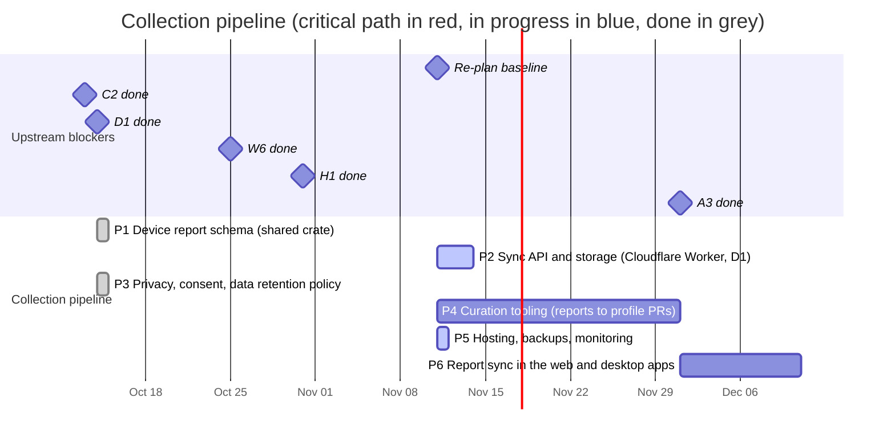

# 03 — Collection pipeline

How device reports are kept, shared and turned into curated profile
updates. Reports are local first
([ADR 0007](../../docs/adr/0007-local-first-device-reports.md), re-planned
in place on 2026-10-14): the desktop app writes files, the web app keeps
them in IndexedDB, people share the ones they choose as GitHub issues, and a
sync server comes after the web launch (M2).

## Schedule

## Tasks

| ID | Task | Days | Blocked by | Blocks | Start | End | Slack |
|----|------|-----:|------------|--------|-------|-----|------:|
| P1 | Device report schema (shared crate) | 7 | C2, D1 | P2, P3, P4, W6, A3, H1 | 2026-10-14 | 2026-10-14 | done |
| P2 | Sync API and storage (Cloudflare Worker, D1) | 3 (of 20) | P1 | P6 | 2026-11-11 | 2026-11-14 | 52 |
| P3 | Privacy, consent, data retention policy | 10 | P1 | W6, A3 | 2026-10-14 | 2026-10-14 | done |
| P4 | Curation tooling (reports to profile PRs) | 20 | P1, D1, H1 | - | 2026-11-11 | 2026-12-01 | 45 |
| P5 | Hosting, backups, monitoring | 1 (of 10) | - | M5 | 2026-11-11 | 2026-11-12 | 64 |
| P6 | Report sync in the web and desktop apps | 10 | P2, W6, A3 | M5 | 2026-12-01 | 2026-12-11 | 35 |

### P1 — Device report schema

Shared crate `anygamepad-report` (plus generated JSON Schema) describing a
report. The web app builds reports with this same crate running in WebAssembly
(TypeScript types come from the `anygamepad-wasm` bindings, C11), so web and
desktop reports are produced by identical code:

- Source (web or desktop), app/browser version, OS and version.
- Identity fields (C2): VID/PID, version, bus, names as reported by each API
  (e.g. the browser Gamepad `id` string, which differs between browsers).
- Per-provider view (desktop): how native, SDL3 and gilrs each see the device
  (C12).
- Raw data when available: HID report descriptor, sample input reports,
  button/axis counts, browser `mapping` value.
- User-confirmed mapping from the guided wizard (W4) and the mode the user says
  the controller is in.
- **Never** serial numbers, Bluetooth MAC addresses or any personal data:
  stripped on the client and validated again by every reader.

Status (2026-10-14): done
(`RECORD/2026-10-14.p1-device-report-schema.completed.md`). The format is
documented in [`data/reports/`](../../data/reports/README.md); its compact
JSON fits a GitHub issue (ADR 0007). The WASM bindings that build reports in
the browser come with W6, their first caller.

### P2 — Sync API and storage (Cloudflare Worker, D1)

Re-planned on 2026-10-14 (ADR 0007): the server is a sync target after the
web launch, not a blocker of it. Rust `axum` service, PostgreSQL storage
([ADR 0006](../../docs/adr/0006-server-stack.md)), validation with the same
crate as the clients, storage of the re-serialized report, deduplication by a
hash of its compact JSON, rate limiting, and an anonymous submission token.

Status (2026-11-02, owner decision): built as a Cloudflare Worker in Rust
with D1 instead of `axum` and PostgreSQL
([ADR 0009](../../docs/adr/0009-sync-server-on-cloudflare-workers.md)), in
`apps/server`: test reports and activity logs from the web app, validated
and stored re-serialized, deduplicated by SHA-256, withdrawn with the
deletion token the app makes, rate limited by an HMAC of the address,
activity logs deleted after 180 days. Tested natively and end-to-end
against a local D1 (`apps/web/tests/smoke-sync.mjs`, CI job `server`).
Left: device reports (with P6), and the deployment (P5)
([`RECORD/2026-11-02.sync-server-on-cloudflare-workers.completed.md`](../../RECORD/2026-11-02.sync-server-on-cloudflare-workers.completed.md)).

Re-planned on 2026-11-11: in progress, 3 days left (of 20) for the device
reports endpoint (validated with `anygamepad-report` like the clients,
deduplicated by hash, withdrawn with the app's token), which P6 needs.
The deployment (P5) no longer waits for it.

### P3 — Privacy, consent, data retention

Privacy policy, explicit consent screen text, retention periods, GDPR data
handling (no IP addresses stored beyond rate limiting), public data license for
the aggregated dataset.

Status (2026-10-14): done
(`RECORD/2026-10-14.p3-privacy-consent-retention.completed.md`). The policy
is a page of the web app, <https://anygamepad.github.io/privacy/>
(`apps/web/privacy/index.html`), linked under the tester; the consent texts
of W6, A3 and the issue form, the retention rules, the handling of shared
reports and the rules for the sync server are in
[`docs/privacy/`](../../docs/privacy/README.md). Owner decisions: reports
are dedicated to the public domain under CC0 1.0
([`data/reports/LICENSE-CC0`](../../data/reports/LICENSE-CC0)); the only
contact channel is this repository's issues; a curated report's issue is
closed and kept, and deleted on request.

### P4 — Curation tooling

Aggregate reports per fingerprint, show disagreements between reports, and
generate profile PRs for `data/profiles/` that a maintainer reviews. Reads
reports from GitHub issues labelled `device-report` and from files (ADR
0007), so it needs P1 only; the sync database becomes one more source after
P2.

Re-planned on 2026-10-31: also blocked by H1. Curation reads test reports
(`data/test-reports/`) as well, which carry ground truth: the model and
mode the person set, and which controls passed.

### P5 — Hosting, backups, monitoring

Deployment target for the sync API and PostgreSQL (the web frontend is
static and lives on GitHub Pages, see W7), automated backups, uptime and error
monitoring. CORS allows the `https://anygamepad.github.io` origin.

Status (2026-11-02): ADR 0009 shrinks it to the owner's account setup and
deployment, written down in
[`apps/server/README.md`](../../apps/server/README.md#deployment-p5): D1 in
the EU, the rate limiter's secret, the migrations, `wrangler deploy`, the
data processing addendum, and the repository variable
`ANYGAMEPAD_SYNC_URL` that turns sending on in the published site.
Since 2026-11-03 the workflow "Deploy server" does the Cloudflare part
from GitHub Actions with the owner's API token
([`RECORD/2026-11-03.server-deploy-workflow.completed.md`](../../RECORD/2026-11-03.server-deploy-workflow.completed.md)).

Re-planned on 2026-11-11: in progress, 1 day left (of 10), all of it the
owner's: the Cloudflare token and the two repository secrets, the first
run of "Deploy server", the repository variable `ANYGAMEPAD_SYNC_URL`, a
run of "Build" on `main`, and the data processing addendum. It no longer
waits for P2: the workflow deploys what P2 has, and P2's device reports
go out with one more run.

Status (2026-11-12, in place): deployed. The repository variable
`ANYGAMEPAD_SYNC_URL` is set (CI's build of 2026-11-11 named a
`workers.dev` server), so the owner ran "Deploy server" and the published
site can send. Left: the data processing addendum (the owner confirms).

### P6 — Report sync in the web and desktop apps

Added on 2026-10-14 (ADR 0007). The web app (IndexedDB, W6) and the desktop
app (report files, A3) upload the reports the person chooses to the sync API,
remember which ones were uploaded, and keep working offline. Consent and
texts follow P3. Reaching milestone M5 (reports synchronized) closes the loop
that issues bridge until then.

Status (2026-11-02, owner request): the web app's settings have a switch
that sends the activity log (in parts) and the saved test reports to the
database, off by default and inert until a build names the server
(`ANYGAMEPAD_SYNC_URL`); `apps/web/src/sync.ts` defines the two endpoints
P2 implements
([`RECORD/2026-11-02.web-test-page-theme-icons-and-sending.completed.md`](../../RECORD/2026-11-02.web-test-page-theme-icons-and-sending.completed.md)).
Later the same day, with the server (ADR 0009, P2 above), each upload
carries a deletion token the page makes, and the settings withdraw
everything the browser sent. Device reports and the desktop app are still
to do.
